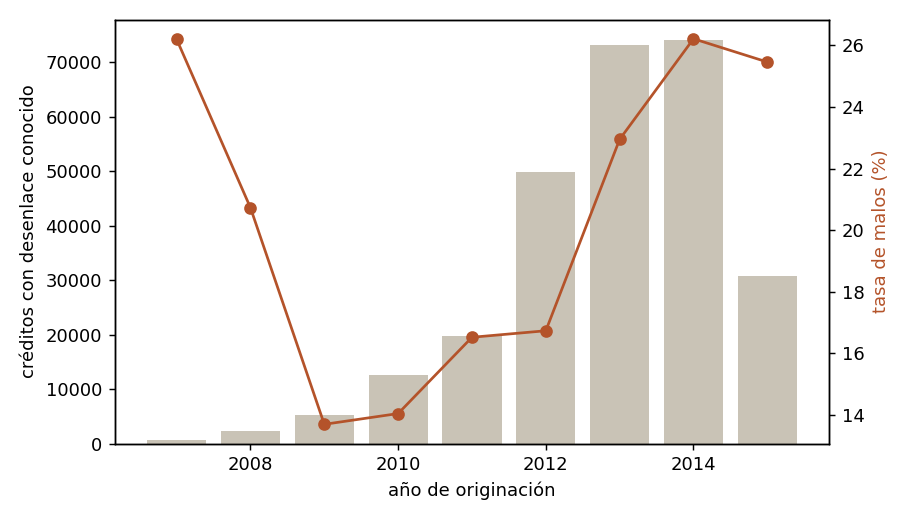
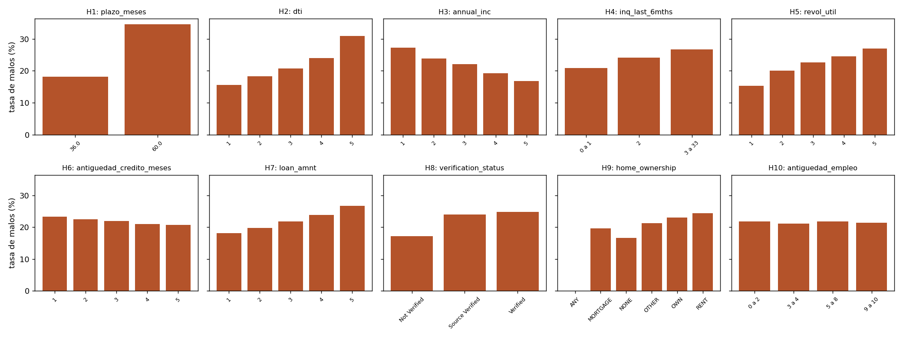
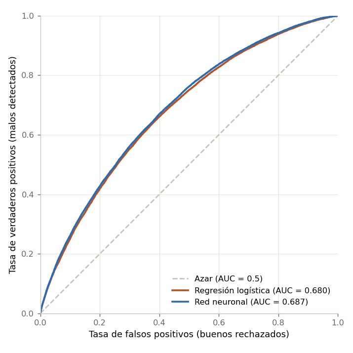
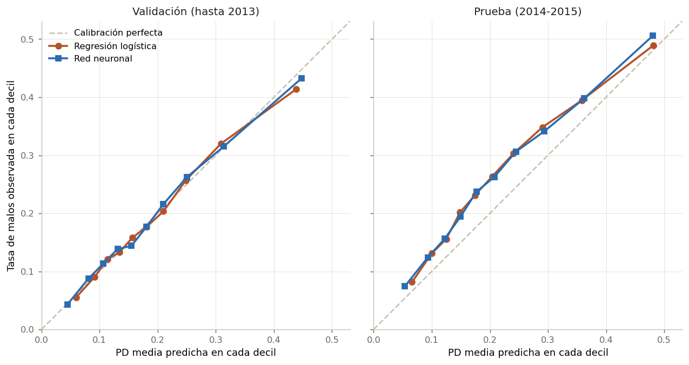
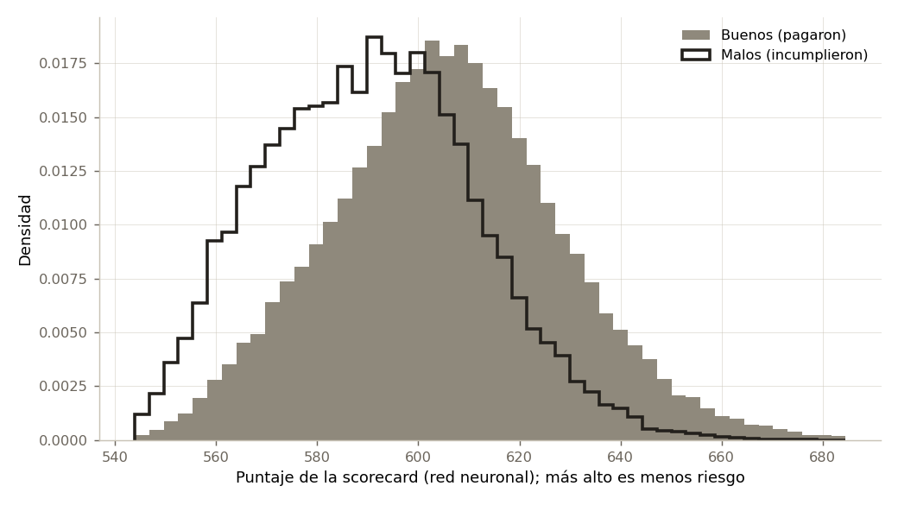
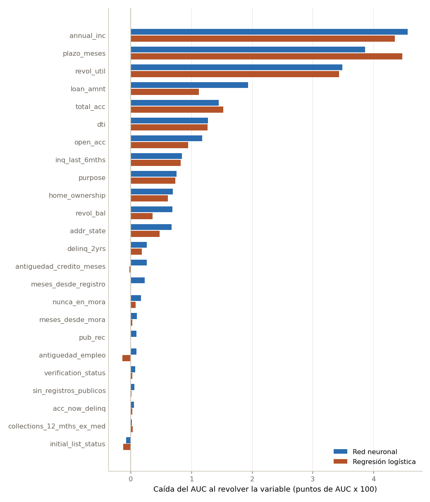
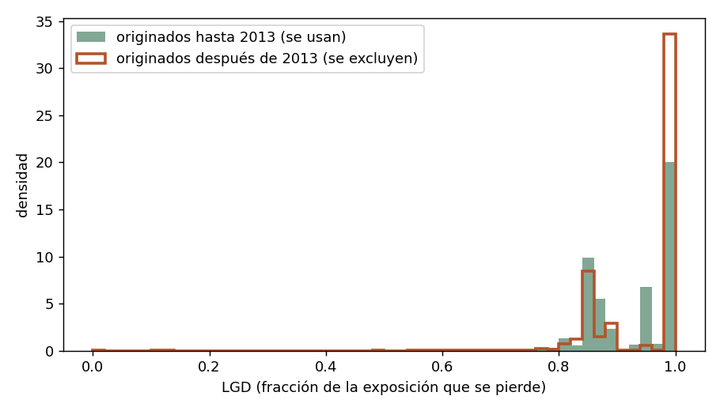
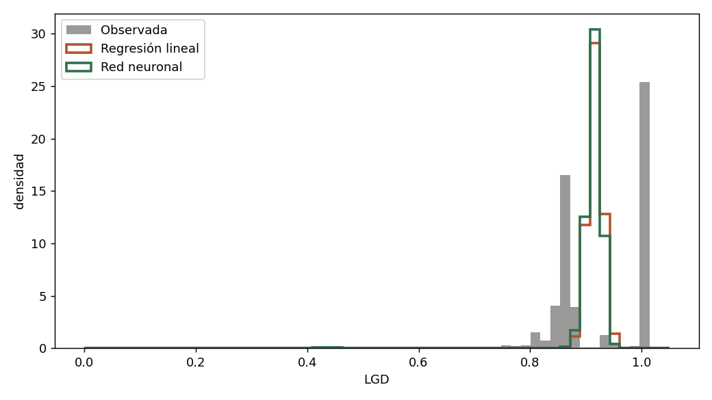

## 1. Introducción y caso de uso

Antes de prestarle dinero a alguien, un banco se hace dos preguntas: qué tan probable es que no le paguen y, si no le pagan, cuánto va a perder. La primera es la **probabilidad de incumplimiento** (PD, por sus siglas en inglés), un problema de clasificación binaria. La segunda es la **pérdida dado incumplimiento** (LGD), la fracción de lo expuesto que finalmente se pierde, un problema de regresión. Juntas, con la **exposición al incumplimiento** (EAD), dan la pérdida esperada de cada crédito:

$$
\mathbb{E}[L] = \text{PD} \cdot \text{LGD} \cdot \text{EAD}
$$

Es la misma descomposición del acuerdo de Basilea II, que define la pérdida esperada de una exposición como $\text{PD} \times \text{LGD}$ y su monto como esa pérdida esperada multiplicada por la EAD (Basel Committee on Banking Supervision [BCBS], 2006, párrs. 375-376).

En este trabajo respondemos las dos preguntas con perceptrones multicapa y las comparamos, bajo las mismas condiciones, con un modelo simple: una regresión logística para la PD y una regresión lineal para la LGD. Las redes neuronales no siempre son la mejor herramienta para datos tabulares, así que el objetivo no es mostrar que la red gana, sino averiguar con evidencia qué aporta y qué no. Además, convertimos el modelo de PD en una scorecard y en una aplicación web en la que cualquier persona puede ver su puntaje.

### 1.1 Caso de uso

Todas las decisiones de modelado del reporte se desprenden de esta descripción:

- **Quién lo usa.** El área de originación de una entidad que presta créditos de consumo por internet, como Lending Club, cuyos datos usamos (sección 2). Una versión simplificada la usa también la persona que va a pedir el crédito, en la aplicación web: le muestra cómo la vería el banco antes de presentar la solicitud.
- **Para qué decisión.** Aprobar o rechazar la solicitud y estimar cuánto se espera perder con ella. La PD y la scorecard ordenan a los solicitantes y permiten fijar un punto de corte; la LGD y la pérdida esperada sirven para provisionar y para comparar el riesgo de la cartera.
- **En qué momento.** Cuando llega la solicitud, antes de aprobar el crédito.
- **Con qué información.** Solo con la que existe en ese momento: lo que la persona declara en la solicitud (ingreso, monto, plazo, propósito, vivienda, antigüedad en el empleo) y lo que dice su reporte de crédito (moras, consultas, líneas abiertas, uso del cupo, registros públicos).

### 1.2 Lo que esto implica para el modelado

1. **Nada del futuro.** No usamos variables de pagos (`total_pymnt`, `recoveries`, `last_pymnt_d`...), porque el día de la solicitud no existen. Tampoco la calificación (`grade`, `sub_grade`) ni la tasa de interés o la cuota que asigna Lending Club, porque son el resultado de su propio modelo de riesgo: usarlas sería copiar ese modelo en lugar de construir el nuestro (sección 2.3).
2. **Partición temporal.** El modelo se entrena con el pasado y se usa con clientes nuevos. Por eso la prueba son los créditos originados después de los de entrenamiento: 2014-2015 en la PD y 2013 en la LGD (secciones 2.4 y 6.1).
3. **La probabilidad tiene que estar bien calibrada,** no solo ordenar bien, porque la PD entra multiplicando en la pérdida esperada. Por eso medimos la calibración (Brier y curva de calibración) y no balanceamos las clases (sección 5.1).
4. **El resultado se tiene que poder explicar.** Al solicitante y al analista no les sirve solo un número: la scorecard reparte el puntaje entre las características de la persona (sección 5.5), y la aplicación lo muestra.
5. **La LGD también se estima al originar,** con las mismas variables de la solicitud, aunque se mida sobre los créditos que ya se castigaron (sección 6).

### 1.3 Contenido del reporte

La sección 2 describe los datos y la variable objetivo; la 3, el análisis descriptivo y las hipótesis sobre qué hace más riesgosa a una persona; la 4, la fundamentación matemática de las redes, las pérdidas, el entrenamiento y las métricas. Las secciones 5 y 6 presentan los modelos de PD (con la scorecard y la interpretación de las variables) y de LGD, y la 7 los combina en la pérdida esperada. La 8 discute qué aportó la red frente a los modelos de referencia y qué aprendimos. Las secciones 9 y 10 cuentan cómo usamos la inteligencia artificial y qué errores suyos encontramos.

### 1.4 Enlaces

- Repositorio con el código, los datos procesados y los modelos: <https://github.com/jperezalv22/trabajo2-riesgo-credito>
- Aplicación web para conocer su puntaje: *(pendiente)*
- Video promocional: *(pendiente)*

## 2. Datos

### 2.1 De dónde salen

Usamos el conjunto *Credit Risk Analysis* publicado en Kaggle (ranadeep, 2021), que reúne los créditos de consumo otorgados por la plataforma estadounidense Lending Club. Lo descargamos el 26 de octubre de 2026. El archivo `loan.csv` tiene 887 379 créditos y 74 variables. Los créditos se originaron entre junio de 2007 y diciembre de 2015, y el último pago registrado es de enero de 2016, así que lo que sabemos de cada crédito es lo que había pasado hasta ese mes.

El conjunto trae un diccionario de variables (`LCDataDictionary.xlsx`, hoja *LoanStats*), que copiamos en `datos/diccionario/` del repositorio. Las definiciones de este reporte salen de ese diccionario y en la Tabla 2 están citadas textualmente, en inglés, como aparecen allí. Solo un nombre no coincide: la columna `verification_status` del archivo aparece en el diccionario como `is_inc_v`.

El archivo original pesa 442 MB y no cabe en el repositorio. Por eso guardamos las tablas ya procesadas (`datos/procesados/pd.parquet` y `lgd.parquet`) junto con el código que las genera desde el original (`python preparar_datos.py`, unos 20 segundos).

### 2.2 Variable objetivo

La variable objetivo `malo` sale de `loan_status` con la codificación del enunciado: 1 si el crédito se castigó, está en mora de más de 30 días o en *Default*; 0 si se pagó completo. Los estados que todavía no tienen un desenlace (*Current*, *Issued*, *In Grace Period* y *Late (16-30 days)*) quedan como NA y no se usan. La Tabla 1 muestra cuántos créditos hay en cada estado.

**Tabla 1.** Estados del crédito (`loan_status`) y su codificación.

| loan_status                                         | Codificación   | Créditos   |
|:----------------------------------------------------|:---------------|:-----------|
| Current                                             | NA             | 601 779    |
| Fully Paid                                          | 0              | 207 723    |
| Charged Off                                         | 1              | 45 248     |
| Late (31-120 days)                                  | 1              | 11 591     |
| Issued                                              | NA             | 8 460      |
| In Grace Period                                     | NA             | 6 253      |
| Late (16-30 days)                                   | NA             | 2 357      |
| Does not meet the credit policy. Status:Fully Paid  | 0              | 1 988      |
| Default                                             | 1              | 1 219      |
| Does not meet the credit policy. Status:Charged Off | 1              | 761        |

*Fuente: elaboración propia con datos de Lending Club (ranadeep, 2021) y la codificación del enunciado.*

Como se ve en la Tabla 1, la mayoría de los créditos todavía se estaba pagando en enero de 2016: 601 779 están en *Current*. En total, 618 849 créditos (69.7 %) quedan como NA. Con desenlace conocido quedan 268 530, de los cuales 58 819 son malos, una tasa de 21.9 %.

### 2.3 Variables de entrada

El modelo se usa cuando una persona pide el crédito, antes de aprobarlo (sección 1). Por eso solo entran variables que se conocen en ese momento: lo que la persona declara en la solicitud y lo que dice su reporte de crédito. La Tabla 2 muestra las 24 variables de entrada (19 numéricas y 5 categóricas), su definición en el diccionario, la transformación que les hicimos y el porcentaje de datos faltantes.

Dejamos por fuera cuatro grupos de variables:

- **Lo que pasa después del préstamo**, como `total_pymnt`, `recoveries`, `last_pymnt_d` u `out_prncp`. En el momento de decidir todavía no existen, y usarlas sería darle al modelo información del futuro.
- **`grade`, `sub_grade`, `int_rate` e `installment`.** El diccionario define `grade` como *"LC assigned loan grade"*: es la calificación que Lending Club le pone a cada crédito con su propio modelo de riesgo, y la tasa de interés y la cuota dependen de ella. Usarlas sería copiar el modelo de Lending Club en vez de construir el nuestro. Las dejamos en las tablas procesadas para quien quiera hacer esa comparación.
- **`tot_cur_bal`, `tot_coll_amt` y `total_rev_hi_lim`.** Están vacías en todos los créditos originados hasta 2011, en el 52 % de los de 2012 y completas desde 2013. Si las usáramos, el modelo podría aprender el año del crédito solo con mirar si están vacías.
- **Los campos de solicitudes conjuntas (`*_joint`, vacíos en el 99.9 %) y los `open_*` e `il_*` (vacíos en el 97.6 %).**

A las variables que quedaron les hicimos estas transformaciones:

- `term` (*"36 months"* o *"60 months"*) pasa a número de meses, y `emp_length` pasa a años, con *"< 1 year"* como 0 y *"10+ years"* como 10, igual que lo describe el diccionario.
- `earliest_cr_line` es una fecha; la convertimos en la antigüedad de la historia crediticia en meses al momento del préstamo.
- En `mths_since_last_delinq` y `mths_since_last_record` un vacío no es un dato perdido: quiere decir que la persona nunca ha estado en mora o nunca ha tenido un registro público. Por eso, antes de imputar, guardamos esa información en dos indicadores, `nunca_en_mora` y `sin_registros_publicos`. Así el modelo no confunde "nunca" con "el valor mediano".
- El ingreso, el monto del préstamo y el saldo revolvente tienen colas muy largas a la derecha; les aplicamos $\log(1 + x)$.
- Las numéricas se imputan con la mediana y se estandarizan. Las categóricas se codifican en *one-hot* y las categorías con menos de 50 créditos se agrupan en una sola.

Todo esto está en `riesgo/preparar.py` y se ajusta **solo con el conjunto de entrenamiento**: la mediana, la media y la desviación de cada variable salen de ahí y se aplican sin cambios a validación y prueba. Todos los modelos de una misma tarea usan el mismo preprocesamiento.

**Tabla 2.** Variables de entrada, definición en el diccionario de Lending Club, transformación y porcentaje de faltantes.

| Variable                   | Columna original           | Definición en el diccionario                                                                                                                                                                             | Transformación                             | Faltantes   |
|:---------------------------|:---------------------------|:---------------------------------------------------------------------------------------------------------------------------------------------------------------------------------------------------------|:-------------------------------------------|:------------|
| loan_amnt                  | loan_amnt                  | The listed amount of the loan applied for by the borrower. If at some point in time, the credit department reduces the loan amount, then it will be reflected in this value.                             | log(1 + x)                                 | 0.0%        |
| plazo_meses                | term                       | The number of payments on the loan. Values are in months and can be either 36 or 60.                                                                                                                     | "36 months" -> 36                          | 0.0%        |
| antiguedad_empleo          | emp_length                 | Employment length in years. Possible values are between 0 and 10 where 0 means less than one year and 10 means ten or more years.                                                                        | "< 1 year" -> 0, "10+ years" -> 10         | 4.0%        |
| annual_inc                 | annual_inc                 | The self-reported annual income provided by the borrower during registration.                                                                                                                            | log(1 + x)                                 | 0.0%        |
| dti                        | dti                        | A ratio calculated using the borrower’s total monthly debt payments on the total debt obligations, excluding mortgage and the requested LC loan, divided by the borrower’s self-reported monthly income. |                                            | 0.0%        |
| delinq_2yrs                | delinq_2yrs                | The number of 30+ days past-due incidences of delinquency in the borrower's credit file for the past 2 years                                                                                             |                                            | 0.0%        |
| antiguedad_credito_meses   | earliest_cr_line           | The month the borrower's earliest reported credit line was opened                                                                                                                                        | meses entre esa fecha y la originación     | 0.0%        |
| inq_last_6mths             | inq_last_6mths             | The number of inquiries in past 6 months (excluding auto and mortgage inquiries)                                                                                                                         |                                            | 0.0%        |
| meses_desde_mora           | mths_since_last_delinq     | The number of months since the borrower's last delinquency.                                                                                                                                              | vacío = nunca (ver nunca_en_mora)          | 55.2%       |
| meses_desde_registro       | mths_since_last_record     | The number of months since the last public record.                                                                                                                                                       | vacío = nunca (ver sin_registros_publicos) | 87.1%       |
| nunca_en_mora              | mths_since_last_delinq     | The number of months since the borrower's last delinquency.                                                                                                                                              | 1 si está vacío, 0 si no                   | 0.0%        |
| sin_registros_publicos     | mths_since_last_record     | The number of months since the last public record.                                                                                                                                                       | 1 si está vacío, 0 si no                   | 0.0%        |
| open_acc                   | open_acc                   | The number of open credit lines in the borrower's credit file.                                                                                                                                           |                                            | 0.0%        |
| pub_rec                    | pub_rec                    | Number of derogatory public records                                                                                                                                                                      |                                            | 0.0%        |
| revol_bal                  | revol_bal                  | Total credit revolving balance                                                                                                                                                                           | log(1 + x)                                 | 0.0%        |
| revol_util                 | revol_util                 | Revolving line utilization rate, or the amount of credit the borrower is using relative to all available revolving credit.                                                                               |                                            | 0.1%        |
| total_acc                  | total_acc                  | The total number of credit lines currently in the borrower's credit file                                                                                                                                 |                                            | 0.0%        |
| collections_12_mths_ex_med | collections_12_mths_ex_med | Number of collections in 12 months excluding medical collections                                                                                                                                         |                                            | 0.1%        |
| acc_now_delinq             | acc_now_delinq             | The number of accounts on which the borrower is now delinquent.                                                                                                                                          |                                            | 0.0%        |
| home_ownership             | home_ownership             | The home ownership status provided by the borrower during registration. Our values are: RENT, OWN, MORTGAGE, OTHER.                                                                                      |                                            | 0.0%        |
| verification_status        | verification_status        | Indicates if income was verified by LC, not verified, or if the income source was verified                                                                                                               | en el diccionario se llama is_inc_v        | 0.0%        |
| purpose                    | purpose                    | A category provided by the borrower for the loan request.                                                                                                                                                |                                            | 0.0%        |
| addr_state                 | addr_state                 | The state provided by the borrower in the loan application                                                                                                                                               |                                            | 0.0%        |
| initial_list_status        | initial_list_status        | The initial listing status of the loan. Possible values are – W, F                                                                                                                                       |                                            | 0.0%        |

*Fuente: elaboración propia; definiciones copiadas de `LCDataDictionary.xlsx`, hoja LoanStats (ranadeep, 2021). Faltantes calculados sobre los 268 530 créditos con desenlace conocido.*

### 2.4 Particiones de entrenamiento, validación y prueba

En la práctica el modelo se entrena con créditos del pasado y se usa con clientes nuevos. Para medir eso, la prueba es temporal: entrenamos y validamos con los créditos originados hasta 2013, y probamos con los originados en 2014 y 2015. Dentro de los años de entrenamiento, el 20 % va a validación, elegido al azar con la semilla 2026 y estratificado por la variable objetivo para que las dos partes tengan la misma tasa de malos. La validación se usa para la parada temprana y para elegir hiperparámetros; la prueba solo se mira al final. La Tabla 3 resume las tres particiones.

**Tabla 3.** Particiones para la probabilidad de incumplimiento.

| Partición     | Créditos   | Años      | Tasa de malos   |
|:--------------|:-----------|:----------|:----------------|
| entrenamiento | 130 832    | 2007-2013 | 19.3%           |
| validacion    | 32 709     | 2007-2013 | 19.3%           |
| prueba        | 104 989    | 2014-2015 | 26.0%           |

*Fuente: elaboración propia (`riesgo/particiones.py`).*

La tasa de malos de la prueba (26.0 %) es bastante más alta que la de entrenamiento (19.3 %). La Tabla 4 y la Figura 1 muestran de dónde viene buena parte de esa diferencia: entre más reciente es el año, menos créditos tienen un desenlace conocido. De los originados en 2012, el 93.3 % ya había terminado en enero de 2016; de los de 2013, el 54.3 %; de los de 2014, el 31.5 %, y de los de 2015, apenas el 7.3 %. Un crédito a 36 meses otorgado en 2014 no alcanza a pagarse completo según el calendario antes de 2016. Los que ya tienen desenlace son los que terminaron antes de tiempo: o lo pagaron por adelantado o cayeron pronto en mora. Por eso, en los años recientes, los malos están sobrerrepresentados.

**Tabla 4.** Créditos por año de originación: cuántos tienen desenlace conocido, su tasa de malos y la proporción a 60 meses.

|   Año | Partición                  | Originados   | Con desenlace conocido   | % con desenlace   | Tasa de malos   | A 60 meses   |
|------:|:---------------------------|:-------------|:-------------------------|:------------------|:----------------|:-------------|
|  2007 | entrenamiento y validación | 603          | 603                      | 100.0%            | 26.2%           | 0.0%         |
|  2008 | entrenamiento y validación | 2 393        | 2 393                    | 100.0%            | 20.7%           | 0.0%         |
|  2009 | entrenamiento y validación | 5 281        | 5 281                    | 100.0%            | 13.7%           | 0.0%         |
|  2010 | entrenamiento y validación | 12 537       | 12 528                   | 99.9%             | 14.0%           | 26.9%        |
|  2011 | entrenamiento y validación | 21 721       | 19 729                   | 90.8%             | 16.5%           | 28.5%        |
|  2012 | entrenamiento y validación | 53 367       | 49 813                   | 93.3%             | 16.7%           | 12.8%        |
|  2013 | entrenamiento y validación | 134 755      | 73 194                   | 54.3%             | 22.9%           | 22.2%        |
|  2014 | prueba                     | 235 628      | 74 154                   | 31.5%             | 26.2%           | 27.5%        |
|  2015 | prueba                     | 421 094      | 30 835                   | 7.3%              | 25.5%           | 31.5%        |

*Fuente: elaboración propia con datos de Lending Club (ranadeep, 2021). "A 60 meses" se calcula sobre los créditos con desenlace conocido.*

**Figura 1.** Créditos con desenlace conocido (barras, eje izquierdo) y tasa de malos (línea, eje derecho) por año de originación. *Fuente: elaboración propia.*

A este efecto lo llamamos sesgo de madurez. Con estos datos no podemos separar cuánto del aumento de la tasa de malos es un deterioro real del riesgo y cuánto es selección por madurez. Lo tenemos en cuenta de tres maneras:

1. Las métricas de discriminación en prueba (AUC, Gini, KS) miden qué tan bien el modelo ordena a los clientes entre los créditos que terminaron rápido, que no es exactamente la población a la que se le prestaría.
2. Un modelo entrenado con una tasa de malos de 19.3 % va a quedarse corto, en promedio, en una prueba con 26.0 %. La curva de calibración de la sección 5 hay que leerla con eso en mente.
3. El sesgo también toca el entrenamiento: 2013 aporta el 45 % de los créditos de entrenamiento y validación, y de ese año solo tiene desenlace el 54.3 %.

Las alternativas, como cortar la prueba en 2013 o quedarse solo con créditos a 36 meses de años ya cerrados, dejan una prueba más limpia pero más vieja y más pequeña. Preferimos la partición que se parece al uso real del modelo y reportar el sesgo.

## 3. Análisis descriptivo: ¿qué hace más riesgosa a una persona?

### 3.1 Hipótesis y cómo las probamos

Antes de mirar los datos escribimos diez hipótesis sobre qué hace más riesgosa a una persona. Cada una dice una variable y en qué dirección esperamos que se mueva el riesgo. Están escritas tal cual en `descriptivo.py`, en la lista `HIPOTESIS`.

Para probarlas comparamos la tasa de malos entre grupos, con los 268 530 créditos que tienen desenlace conocido:

- Si la variable es numérica, partimos a las personas en quintiles (cinco grupos del mismo tamaño) y comparamos el quintil más alto con el más bajo.
- Si es categórica, comparamos los dos grupos que nombra la hipótesis; por ejemplo, quien arrienda contra quien tiene hipoteca.

Una hipótesis se confirma si la diferencia va en la dirección esperada y es de al menos un punto porcentual. Ese umbral no es arbitrario del todo. Cada quintil tiene unos 53 700 créditos, y con una tasa cercana al 20 % el error estándar de la diferencia entre dos quintiles es de $\sqrt{2 \cdot 0.2 \cdot 0.8 / 53\,700} \approx 0.24$ puntos porcentuales. Un punto equivale entonces a unos cuatro errores estándar: una diferencia de ese tamaño difícilmente sale por azar.

Este análisis tiene dos límites. Mira una variable a la vez, así que una hipótesis puede confirmarse por culpa de otra variable relacionada; el plazo y el monto, por ejemplo, van de la mano. Además, muestra asociaciones, no causas. En la sección 5 volvemos a estas hipótesis con el modelo, que sí tiene en cuenta todas las variables al tiempo.

### 3.2 Resultados

La Tabla 5 resume las diez hipótesis y la Figura 2 muestra la tasa de malos en cada grupo.

**Tabla 5.** Hipótesis sobre el riesgo y tasa de malos en los grupos comparados.

| Hipótesis   | Qué esperábamos                                                               | Tasa de malos                          | ¿Se confirma?   |
|:------------|:------------------------------------------------------------------------------|:---------------------------------------|:----------------|
| H1          | Los créditos a 60 meses son más riesgosos que a 36                            | 60 meses: 34.6% vs 36 meses: 18.1%     | Sí              |
| H2          | Quien ya debe más en proporción a su ingreso es más riesgoso                  | quintil 5: 31.0% vs quintil 1: 15.6%   | Sí              |
| H3          | A mayor ingreso, menor riesgo                                                 | quintil 5: 16.8% vs quintil 1: 27.3%   | Sí              |
| H4          | Muchas consultas recientes de crédito indican necesidad de plata y más riesgo | quintil 5: 26.0% vs quintil 1: 18.3%   | Sí              |
| H5          | Quien usa casi todo su cupo de tarjetas es más riesgoso                       | quintil 5: 27.0% vs quintil 1: 15.3%   | Sí              |
| H6          | Una historia crediticia más larga indica menos riesgo                         | quintil 5: 20.8% vs quintil 1: 23.3%   | Sí              |
| H7          | Los préstamos más grandes son más riesgosos                                   | quintil 5: 26.5% vs quintil 1: 18.1%   | Sí              |
| H8          | Si el ingreso fue verificado, el riesgo es menor                              | Verified: 24.7% vs Not Verified: 17.1% | No              |
| H9          | Quien arrienda es más riesgoso que quien tiene casa o hipoteca                | RENT: 24.4% vs MORTGAGE: 19.6%         | Sí              |
| H10         | Más años en el mismo empleo, menos riesgo                                     | quintil 5: 21.3% vs quintil 1: 21.5%   | No              |

*Fuente: elaboración propia con datos de Lending Club (ranadeep, 2021).*

**Figura 2.** Tasa de malos por grupo para cada hipótesis. En las variables numéricas, los grupos son quintiles (1 = valores más bajos). *Fuente: elaboración propia.*

Se confirman ocho de las diez. Las diferencias más grandes están en el plazo (H1: 34.6 % de malos a 60 meses contra 18.1 % a 36) y en la deuda frente al ingreso (H2: 31.0 % en el quintil más alto de `dti` contra 15.6 % en el más bajo). Les siguen el uso del cupo de las tarjetas (H5), el ingreso (H3), el monto del préstamo (H7) y las consultas recientes de crédito (H4). En la Figura 2 se ve que en todas estas la tasa sube o baja de forma ordenada de un quintil al siguiente, no solo entre los extremos.

H6 se confirma, pero por poco: la diferencia es de 2.5 puntos (20.8 % contra 23.3 %). H9 también se confirma: quien arrienda tiene 24.4 % de malos y quien tiene hipoteca, 19.6 %.

H10 no se confirma. La tasa de malos es prácticamente la misma en todos los quintiles de antigüedad en el empleo (21.3 % en el más alto y 21.5 % en el más bajo). Saber cuántos años lleva alguien en su trabajo no ayuda, por sí solo, a separar buenos de malos.

### 3.3 La hipótesis que salió al revés: el ingreso verificado

H8 salió al contrario de lo esperado. Los créditos con ingreso verificado tienen más malos (24.7 %) que los no verificados (17.1 %). Nuestra primera sospecha fue el monto: si Lending Club verifica más a quien pide más plata, y los préstamos grandes son más riesgosos (H7), la verificación estaría heredando ese riesgo. La Tabla 6 lo revisa por quintil de monto.

**Tabla 6.** Proporción de créditos sin verificar y tasa de malos por estado de verificación, dentro de cada quintil del monto del préstamo.

|   Quintil de monto | Monto máximo   | Sin verificar   | Malos: Not Verified   | Malos: Source Verified   | Malos: Verified   |
|-------------------:|:---------------|:----------------|:----------------------|:-------------------------|:------------------|
|                  1 | 6 250          | 51.9%           | 16.5%                 | 18.5%                    | 21.3%             |
|                  2 | 10 000         | 45.6%           | 16.8%                 | 20.7%                    | 22.3%             |
|                  3 | 14 400         | 38.3%           | 17.0%                 | 25.3%                    | 24.4%             |
|                  4 | 20 000         | 27.7%           | 18.1%                 | 26.2%                    | 25.6%             |
|                  5 | 35 000         | 5.3%            | 21.4%                 | 27.0%                    | 26.7%             |

*Fuente: elaboración propia con datos de Lending Club (ranadeep, 2021). Montos en dólares.*

Como muestra la Tabla 6, la sospecha era en parte cierta. La verificación depende mucho del monto: en el quintil más bajo la mitad de los créditos (51.9 %) no se verificó, y en el más alto solo el 5.3 %. Pero eso no explica todo, porque dentro de cada quintil los verificados siguen siendo más riesgosos que los no verificados: 21.3 % contra 16.5 % en el primero y 26.7 % contra 21.4 % en el quinto.

Concluimos que la verificación no se asigna al azar. Lending Club decide a quién se la pide, y si se la pide más a quien le parece más riesgoso por razones que no vemos en los datos, el grupo verificado carga con ese riesgo. Esto último es una conjetura: no encontramos una fuente primaria de Lending Club que describa su criterio de verificación, así que lo dejamos como pregunta abierta.

Para un modelo predictivo, "verificado" sí indica más riesgo y es correcto usarlo. Como consejo sería un error: no verificar el ingreso no hace a nadie mejor pagador. Por eso, en la aplicación, el "¿qué pasaría si...?" no debería sugerir cambiar el estado de verificación como forma de mejorar el puntaje.

## 4. Fundamentos matemáticos

Esta sección define todo lo que usan los modelos de las secciones 5 y 6: qué es una neurona y una red, de dónde salen las funciones de pérdida, cómo se calculan los gradientes, cómo se actualizan los pesos, cómo se regulariza y cómo se mide el resultado. La notación es la misma en todo el reporte: $x_i \in \mathbb{R}^d$ son las $d$ columnas de entrada del crédito $i$ después del preprocesamiento (89 en la PD y 77 en la LGD), $y_i$ es el valor observado (0 o 1 en la PD, una fracción entre 0 y 1 en la LGD) y $\hat{y}_i$ es lo que predice el modelo.

### 4.1 Neurona artificial

Una neurona artificial recibe un vector de entradas $x \in \mathbb{R}^d$, calcula una suma ponderada más un sesgo y le aplica una función de activación $\varphi$:

$$
z = w^\top x + b = \sum_{j=1}^{d} w_j x_j + b, \qquad a = \varphi(z)
$$

Los pesos $w \in \mathbb{R}^d$ y el sesgo $b \in \mathbb{R}$ son los parámetros que se aprenden; $z$ es la preactivación y $a$, la salida de la neurona. La idea viene del modelo de McCulloch y Pitts (1943), con salidas binarias, y del perceptrón de Rosenblatt (1958), que aprendía los pesos a partir de ejemplos.

Una sola neurona con activación sigmoide ya es la regresión logística de la sección 5: $\hat{p} = \sigma(w^\top x + b)$. Lo que agrega una red es poner neuronas en capas.

### 4.2 Perceptrón multicapa

Un perceptrón multicapa con $L$ capas ocultas encadena neuronas en capas. La capa $l$ tiene $n_l$ neuronas; cada una recibe todas las salidas de la capa anterior. Con $h^{(0)} = x$ y $n_0 = d$:

$$
z^{(l)} = W^{(l)} h^{(l-1)} + b^{(l)}, \qquad h^{(l)} = \varphi\left(z^{(l)}\right), \qquad l = 1, \dots, L
$$

donde $W^{(l)} \in \mathbb{R}^{n_l \times n_{l-1}}$ es la matriz de pesos (la fila $k$ son los pesos de la neurona $k$), $b^{(l)} \in \mathbb{R}^{n_l}$ son los sesgos y $\varphi$ se aplica a cada componente. La salida es una sola neurona con activación sigmoide:

$$
\hat{y} = \sigma\left(z^{(L+1)}\right), \qquad z^{(L+1)} = w^{(L+1)\top} h^{(L)} + b^{(L+1)}
$$

Es lo que hace `crear_red` en `riesgo/red.py`: `capas=[128, 64]` es $L = 2$, con $n_1 = 128$ y $n_2 = 64$. El número de parámetros entrenables es

$$
\sum_{l=1}^{L+1} (n_{l-1} + 1)\, n_l, \qquad n_{L+1} = 1
$$

Para la red de la PD (89 entradas, capas de 128 y 64) da $90 \cdot 128 + 129 \cdot 64 + 65 \cdot 1 = 19\,841$, el número que reporta la sección 5. Para la de la LGD (77 entradas, capas de 64 y 32), $78 \cdot 64 + 65 \cdot 32 + 33 = 7\,105$.

¿Por qué capas? Con una sola capa oculta, una activación de tipo sigmoide y suficientes neuronas, un perceptrón multicapa puede aproximar cualquier función continua sobre un conjunto compacto tan bien como se quiera (Hornik et al., 1989). Eso dice que la red *puede* representar relaciones no lineales entre las variables; no dice que las vaya a aprender con los datos que tenemos, ni que esas relaciones existan. Las secciones 5 y 6 miden cuánto ganamos con eso en la práctica.

### 4.3 Funciones de activación

La Tabla 7 resume las tres activaciones que usamos y sus derivadas, que son las que necesita la retropropagación (sección 4.5).

**Tabla 7.** Funciones de activación usadas, sus derivadas y dónde aparecen.

| Activación | $\varphi(z)$ | $\varphi'(z)$ | Rango | Dónde se usa |
|:--|:--|:--|:--|:--|
| ReLU | $\max(0, z)$ | $1$ si $z > 0$; $0$ si $z < 0$ | $[0, \infty)$ | Capas ocultas de la red de la PD |
| Tangente hiperbólica | $\tanh z = \dfrac{e^{z} - e^{-z}}{e^{z} + e^{-z}}$ | $1 - \tanh^2 z$ | $(-1, 1)$ | Capas ocultas de la red de la LGD |
| Sigmoide | $\sigma(z) = \dfrac{1}{1 + e^{-z}}$ | $\sigma(z)\,(1 - \sigma(z))$ | $(0, 1)$ | Neurona de salida de las dos redes |

*Fuente: elaboración propia. Las activaciones de cada red salen de la búsqueda de hiperparámetros (secciones 5.2 y 6.3).*

Algunos detalles que importan:

- **ReLU** (Nair y Hinton, 2010) no es derivable en $z = 0$. PyTorch usa 0 como derivada en ese punto; en la práctica casi nunca se cae exactamente en 0. Su derivada es 1 para toda $z > 0$, así que el gradiente no se encoge al pasar por muchas capas, como sí pasa con la sigmoide.
- **tanh** es una sigmoide reescalada: $\tanh z = 2\sigma(2z) - 1$. Está centrada en cero, pero se satura igual: para $|z|$ grande, $1 - \tanh^2 z \approx 0$.
- **Sigmoide.** La derivada sale de derivar $(1 + e^{-z})^{-1}$:

$$
\sigma'(z) = \frac{e^{-z}}{(1 + e^{-z})^2} = \frac{1}{1 + e^{-z}} \cdot \frac{e^{-z}}{1 + e^{-z}} = \sigma(z)\,\bigl(1 - \sigma(z)\bigr)
$$

porque $\dfrac{e^{-z}}{1 + e^{-z}} = 1 - \dfrac{1}{1 + e^{-z}}$. La usamos en la salida porque las dos cosas que estimamos están entre 0 y 1: la PD es una probabilidad y la LGD es una fracción. Como $\sigma(z) \in (0, 1)$ para todo $z$, la red nunca predice algo imposible, como una PD negativa o una LGD de 1.3. La sección 6 muestra que la regresión lineal sí puede salirse de ese rango.

### 4.4 Funciones de pérdida por máxima verosimilitud

Una función de pérdida no se escoge al gusto: cada una corresponde a un supuesto sobre cómo se generan los datos. Si suponemos un modelo probabilístico para $y_i$ dado $x_i$, con parámetros $\theta$, el principio de máxima verosimilitud pide los $\theta$ que hacen más probable lo observado. Con observaciones independientes, la verosimilitud es un producto, y es más cómodo maximizar su logaritmo:

$$
\hat{\theta} = \arg\max_\theta \prod_{i=1}^{n} f(y_i \mid x_i; \theta) = \arg\min_\theta \left[ -\frac{1}{n} \sum_{i=1}^{n} \ln f(y_i \mid x_i; \theta) \right]
$$

El logaritmo no cambia dónde está el máximo porque es creciente, y dividir por $n$ tampoco. Lo que queda entre corchetes, el negativo del logaritmo de la verosimilitud promediado, es la función de pérdida que se minimiza.

**Entropía cruzada binaria, desde Bernoulli (PD).** Si $y_i \in \{0, 1\}$ y el modelo dice que la probabilidad de ser malo es $\hat{p}_i$, entonces $y_i \sim \text{Bernoulli}(\hat{p}_i)$:

$$
f(y_i \mid x_i; \theta) = \hat{p}_i^{\,y_i} (1 - \hat{p}_i)^{1 - y_i}
$$

que vale $\hat{p}_i$ si $y_i = 1$ y $1 - \hat{p}_i$ si $y_i = 0$. Su logaritmo es $y_i \ln \hat{p}_i + (1 - y_i) \ln(1 - \hat{p}_i)$, y con el signo menos y el promedio queda la entropía cruzada binaria:

$$
\mathcal{L}_{\text{BCE}} = -\frac{1}{n} \sum_{i=1}^{n} \Bigl[ y_i \ln \hat{p}_i + (1 - y_i) \ln (1 - \hat{p}_i) \Bigr]
$$

Es lo que calcula `nn.BCELoss()` de PyTorch, que por defecto promedia sobre el lote. Su derivada respecto a la preactivación de salida es muy simple. Por la regla de la cadena, con $\hat{p}_i = \sigma(z_i)$, para un crédito:

$$
\frac{\partial \ell_i}{\partial \hat{p}_i} = -\frac{y_i}{\hat{p}_i} + \frac{1 - y_i}{1 - \hat{p}_i} = \frac{\hat{p}_i - y_i}{\hat{p}_i (1 - \hat{p}_i)}, \qquad \frac{\partial \ell_i}{\partial z_i} = \frac{\hat{p}_i - y_i}{\hat{p}_i (1 - \hat{p}_i)} \cdot \hat{p}_i (1 - \hat{p}_i) = \hat{p}_i - y_i
$$

donde $\ell_i = -[y_i \ln \hat{p}_i + (1 - y_i) \ln (1 - \hat{p}_i)]$. El factor $\hat{p}_i(1 - \hat{p}_i)$ de la sigmoide se cancela. Por eso la sigmoide y la entropía cruzada van juntas: el gradiente es el error de predicción, sin ningún factor que lo apague cuando la sigmoide se satura.

**Entropía cruzada con objetivo fraccional (LGD).** En la LGD $y_i \in [0, 1]$ no es 0 o 1, así que la Bernoulli no es una distribución posible para $y_i$ y $\mathcal{L}_{\text{BCE}}$ ya no es una verosimilitud. Es una *cuasi-verosimilitud* (Papke y Wooldridge, 1996): se usa la misma fórmula y lo único que se supone es que el modelo para la media, $\mathbb{E}[y \mid x] = \hat{y}$, es correcto. La sección 6.2 muestra por qué basta con eso: la pérdida esperada se minimiza justo en $\hat{y} = \mathbb{E}[y \mid x]$.

**Error cuadrático, desde Gauss.** Si suponemos $y_i = \hat{y}_i + \varepsilon_i$ con $\varepsilon_i \sim \mathcal{N}(0, s^2)$ independientes y $s$ fija, entonces

$$
f(y_i \mid x_i; \theta) = \frac{1}{\sqrt{2\pi s^2}} \exp\left( -\frac{(y_i - \hat{y}_i)^2}{2 s^2} \right)
$$

y el negativo del logaritmo de la verosimilitud es

$$
-\sum_{i=1}^{n} \ln f(y_i \mid x_i; \theta) = \frac{n}{2} \ln (2\pi s^2) + \frac{1}{2 s^2} \sum_{i=1}^{n} (y_i - \hat{y}_i)^2
$$

El primer término no depende de $\theta$ y $1/(2s^2)$ es una constante positiva, así que minimizarlo es lo mismo que minimizar el error cuadrático medio:

$$
\mathcal{L}_{\text{MSE}} = \frac{1}{n} \sum_{i=1}^{n} (y_i - \hat{y}_i)^2
$$

Es lo que optimiza la regresión lineal de la LGD (mínimos cuadrados) y la red de la LGD con `--set lgd.perdida=mse`. Con una salida sigmoide, su derivada respecto a $z_i$ es $\frac{2}{n} (\hat{y}_i - y_i)\, \hat{y}_i (1 - \hat{y}_i)$ (el $\frac{1}{n}$ por el promedio y el 2 por el cuadrado). Aquí el factor de la sigmoide no se cancela: cerca de 0 o de 1 la red aprende muy despacio, y en la LGD el 45 % de los créditos de prueba tiene LGD = 1 (sección 6). Además, la Gaussiana supone que $y$ puede tomar cualquier valor real, y la LGD no. Por las dos razones usamos la entropía cruzada por defecto y dejamos el error cuadrático para comparar.

### 4.5 Retropropagación

Para minimizar la pérdida hace falta su gradiente respecto a cada peso. La retropropagación (Rumelhart et al., 1986) lo calcula aplicando la regla de la cadena de la salida hacia la entrada, capa por capa, y reutilizando lo que ya calculó.

Para un crédito, se define el error de la capa $l$ como la derivada de la pérdida respecto a su preactivación, $\delta^{(l)} = \partial \ell / \partial z^{(l)} \in \mathbb{R}^{n_l}$. El algoritmo tiene cuatro pasos:

1. **Hacia adelante.** Calcular y guardar $z^{(l)}$ y $h^{(l)}$ de todas las capas con las ecuaciones de la sección 4.2.
2. **Error de salida.** Con sigmoide y entropía cruzada, por la sección 4.4: $\delta^{(L+1)} = \hat{y} - y$.
3. **Hacia atrás.** Para $l = L, \dots, 1$:

$$
\delta^{(l)} = \left( W^{(l+1)\top} \delta^{(l+1)} \right) \odot \varphi'\left(z^{(l)}\right)
$$

   donde $\odot$ es el producto componente a componente. Sale de la regla de la cadena: $z^{(l)}_k$ afecta la pérdida a través de todas las neuronas $j$ de la capa siguiente, con $\partial z^{(l+1)}_j / \partial z^{(l)}_k = W^{(l+1)}_{jk}\, \varphi'(z^{(l)}_k)$, y por eso $\delta^{(l)}_k = \sum_j \delta^{(l+1)}_j W^{(l+1)}_{jk}\, \varphi'(z^{(l)}_k)$. La suma sobre $j$ es lo que escribe la matriz transpuesta.

4. **Gradientes.** Como $z^{(l)}_j = \sum_k W^{(l)}_{jk} h^{(l-1)}_k + b^{(l)}_j$:

$$
\frac{\partial \ell}{\partial W^{(l)}} = \delta^{(l)} \, h^{(l-1)\top}, \qquad \frac{\partial \ell}{\partial b^{(l)}} = \delta^{(l)}
$$

Con un lote de $m$ créditos y la pérdida promediada, los gradientes son el promedio de los de cada crédito. En el código todo esto lo hace `perdida_lote.backward()`, que aplica estas mismas reglas sobre el grafo de operaciones que PyTorch guardó en el paso hacia adelante; `optimizador.step()` usa después esos gradientes para actualizar los pesos (sección 4.6).

### 4.6 Optimizador: Adam

El descenso de gradiente más simple actualiza $\theta \leftarrow \theta - \alpha\, g$, con $g$ el gradiente del lote y $\alpha$ la tasa de aprendizaje. Adam (Kingma y Ba, 2015) le agrega dos promedios móviles por parámetro: uno del gradiente (la dirección) y otro del gradiente al cuadrado (el tamaño típico). En el paso $t$, con $m_0 = v_0 = 0$:

$$
\begin{aligned}
g_t &= \nabla_\theta \mathcal{L}(\theta_{t-1}) + \lambda\, \theta_{t-1} \\
m_t &= \beta_1 m_{t-1} + (1 - \beta_1)\, g_t \\
v_t &= \beta_2 v_{t-1} + (1 - \beta_2)\, g_t^2 \\
\hat{m}_t &= \frac{m_t}{1 - \beta_1^t}, \qquad \hat{v}_t = \frac{v_t}{1 - \beta_2^t} \\
\theta_t &= \theta_{t-1} - \alpha\, \frac{\hat{m}_t}{\sqrt{\hat{v}_t} + \epsilon}
\end{aligned}
$$

Las operaciones son componente a componente. Usamos los valores por defecto de PyTorch, $\beta_1 = 0.9$, $\beta_2 = 0.999$ y $\epsilon = 10^{-8}$, y la tasa $\alpha$ que eligió la búsqueda ($3 \cdot 10^{-4}$ en la PD y $10^{-3}$ en la LGD). El término $\lambda\theta_{t-1}$ es la penalización $L_2$ (sección 4.7).

Por qué cada pieza:

- **$m_t$** suaviza el gradiente de lote a lote, como un momento: las direcciones que se repiten se refuerzan y el ruido se cancela.
- **$\sqrt{\hat{v}_t}$** divide cada componente por su tamaño típico, así que cada parámetro tiene, en la práctica, su propia tasa de aprendizaje. El paso queda del orden de $\alpha$ aunque el gradiente sea muy grande o muy pequeño.
- **La corrección de sesgo** $1 - \beta^t$ existe porque $m_0 = v_0 = 0$: en los primeros pasos los promedios están sesgados hacia cero. Por ejemplo, en $t = 1$, $m_1 = (1 - \beta_1) g_1 = 0.1\, g_1$, y al dividir por $1 - \beta_1 = 0.1$ se recupera $\hat{m}_1 = g_1$.

Comprobamos estas ecuaciones contra el código instalado de PyTorch 2.13.0 (`torch/optim/adam.py`): calcula el paso como $\frac{\alpha}{1 - \beta_1^t} \cdot \frac{m_t}{\sqrt{v_t}/\sqrt{1 - \beta_2^t} + \epsilon}$, que es la misma expresión.

La búsqueda de la PD también probó RMSprop (Hinton et al., 2012), que es Adam sin el promedio del gradiente ni la corrección de sesgo: $v_t = \rho\, v_{t-1} + (1 - \rho)\, g_t^2$ y $\theta_t = \theta_{t-1} - \alpha\, g_t / (\sqrt{v_t} + \epsilon)$. Las diapositivas originales usan $\rho = 0.9$; PyTorch usa $\rho = 0.99$ por defecto, y ese es el valor con que corrió nuestra búsqueda.

### 4.7 Regularización

Una red con miles de parámetros puede memorizar el ruido del entrenamiento. Usamos tres técnicas para evitarlo, y sus intensidades son hiperparámetros de la búsqueda.

**Penalización $L_2$.** Se le suma a la pérdida el cuadrado de la norma de los parámetros:

$$
J(\theta) = \mathcal{L}(\theta) + \frac{\lambda}{2} \lVert \theta \rVert_2^2, \qquad \nabla_\theta J = \nabla_\theta \mathcal{L} + \lambda\, \theta
$$

Así, los pesos grandes cuestan, y la red prefiere soluciones más suaves. En el código es `weight_decay=λ` de PyTorch, que suma exactamente $\lambda\theta$ al gradiente antes de entrar a Adam (la primera línea de las ecuaciones de la sección 4.6). Hay dos detalles. Primero, se aplica a todos los parámetros, sesgos incluidos. Segundo, como el término pasa por la división entre $\sqrt{\hat{v}_t}$, en Adam no equivale a encoger cada peso en la misma proporción. Esa otra versión, el *weight decay desacoplado* de AdamW (Loshchilov y Hutter, 2019), no es la que usamos. La regresión logística también lleva $L_2$, con $C$ como el inverso de su fuerza (sección 5.1).

**Dropout.** En cada paso de entrenamiento, cada neurona oculta se apaga con probabilidad $q$, independiente de las demás (Srivastava et al., 2014). Con $r_k \sim \text{Bernoulli}(1 - q)$:

$$
\tilde{h}^{(l)}_k = \frac{r_k}{1 - q}\, h^{(l)}_k
$$

Dividir por $1 - q$ hace que el valor esperado no cambie: $\mathbb{E}[\tilde{h}_k] = \frac{(1 - q)\, h_k}{1 - q} = h_k$. Por eso, al predecir, el dropout se apaga y no hay que corregir nada. Es lo que hace `nn.Dropout(q)` de PyTorch entre `red.train()` y `red.eval()`. (El artículo original no divide al entrenar, sino que multiplica los pesos por $1 - q$ al predecir. En valor esperado es lo mismo.) La idea es que ninguna neurona puede depender de que otra esté presente. En la retropropagación, el gradiente pasa solo por las neuronas que quedaron encendidas, multiplicado por el mismo $r_k / (1 - q)$. La red de la PD usa $q = 0.3$ y la de la LGD, $q = 0$.

**Parada temprana.** Después de cada época se mide la pérdida en validación, $\mathcal{L}_{\text{val}}(\theta_e)$. Se guarda la mejor época,

$$
e^* = \arg\min_{e' \le e} \mathcal{L}_{\text{val}}(\theta_{e'})
$$

y el entrenamiento se detiene en la primera época $e$ con $e - e^* \ge P$, donde $P$ es la paciencia ($P = 6$ en `config.yaml`), o al llegar al máximo de 60 épocas. Al final se recuperan los pesos $\theta_{e^*}$. Regulariza porque la red deja de ajustarse justo cuando empieza a mejorar en entrenamiento y a empeorar en datos que no ve. Hay muchos criterios para decidir cuándo parar (Prechelt, 1998); el nuestro, la paciencia, es uno de los más simples. La decisión la toma la validación, nunca la prueba.

### 4.8 Métricas de evaluación

La Tabla 8 resume las métricas y qué miden. Las de clasificación están en `riesgo/metricas.py` y se comprobaron a mano en un caso pequeño (`python pd_verificar.py`).

**Tabla 8.** Métricas de evaluación usadas en el reporte.

| Métrica | Tarea | Qué mide | Rango | Mejor |
|:--|:--|:--|:--|:--|
| AUC | PD | Discriminación: si los malos tienen PD más alta que los buenos | $[0, 1]$, 0.5 es azar | Más alto |
| Gini | PD | Lo mismo que el AUC, en otra escala | $[-1, 1]$, 0 es azar | Más alto |
| KS | PD | La mayor separación entre las PD de malos y de buenos | $[0, 1]$ | Más alto |
| Brier | PD | Calibración y discriminación juntas: el error cuadrático de la probabilidad | $[0, 1]$ | Más bajo |
| MAE | LGD | Error típico en unidades de LGD | $[0, \infty)$ | Más bajo |
| RMSE | LGD | Error típico, castigando más los errores grandes | $[0, \infty)$ | Más bajo |

*Fuente: elaboración propia.*

**Curva ROC y AUC.** Para un umbral $t$, se predice "malo" si $\hat{p}_i > t$. La tasa de verdaderos positivos es la fracción de malos que el umbral atrapa y la de falsos positivos, la fracción de buenos que rechaza sin razón:

$$
\text{TPR}(t) = \frac{\#\{i : y_i = 1,\ \hat{p}_i > t\}}{n_1}, \qquad \text{FPR}(t) = \frac{\#\{i : y_i = 0,\ \hat{p}_i > t\}}{n_0}
$$

con $n_1$ malos y $n_0$ buenos. La curva ROC une los puntos $(\text{FPR}(t), \text{TPR}(t))$ al mover $t$, y el AUC es el área bajo ella (Fawcett, 2006). Tiene una lectura más directa: es la probabilidad de que un malo tomado al azar tenga una PD más alta que un bueno tomado al azar, con los empates valiendo la mitad (Hanley y McNeil, 1982):

$$
\text{AUC} = \frac{1}{n_1 n_0} \sum_{i : y_i = 1} \sum_{j : y_j = 0} \left( \mathbb{1}[\hat{p}_i > \hat{p}_j] + \tfrac{1}{2}\, \mathbb{1}[\hat{p}_i = \hat{p}_j] \right)
$$

Solo depende del orden de las PD, no de su valor. Por eso no cambia con la escala de la scorecard (sección 5.5).

**Índice de Gini.** $\text{Gini} = 2\,\text{AUC} - 1$. Es el AUC reescalado para que el azar sea 0 y la separación perfecta, 1.

**Estadístico KS.** Es la mayor distancia vertical entre las distribuciones acumuladas de la PD de malos y de buenos, que en un umbral $t$ son $1 - \text{TPR}(t)$ y $1 - \text{FPR}(t)$:

$$
\text{KS} = \max_t \bigl| \text{TPR}(t) - \text{FPR}(t) \bigr|
$$

Es el estadístico de la prueba de Kolmogorov-Smirnov de dos muestras (Massey, 1951) aplicado a las PD de los dos grupos. En la curva ROC es la mayor distancia vertical entre la curva y la diagonal.

**Puntaje de Brier.** El error cuadrático medio de la probabilidad, con $y_i \in \{0, 1\}$ (Brier, 1950):

$$
\text{Brier} = \frac{1}{n} \sum_{i=1}^{n} (\hat{p}_i - y_i)^2
$$

A diferencia de las anteriores, sí depende del valor de las PD: un modelo que ordena bien, pero dice 40 % donde la tasa real es 20 %, tiene buen AUC y mal Brier. Como referencia, predecir para todos la tasa de malos $\pi$ de la partición da $\text{Brier} = \pi(1 - \pi)$ (sección 5.4).

**Curva de calibración.** Se ordenan los créditos por PD predicha, se parten en diez grupos del mismo tamaño (deciles) y en cada uno se compara la PD media predicha con la tasa de malos observada. Si el modelo está bien calibrado, los puntos caen sobre la diagonal.

**MAE y RMSE (LGD).**

$$
\text{MAE} = \frac{1}{n} \sum_{i=1}^{n} \lvert y_i - \hat{y}_i \rvert, \qquad \text{RMSE} = \sqrt{\frac{1}{n} \sum_{i=1}^{n} (y_i - \hat{y}_i)^2}
$$

Los dos están en unidades de LGD: un MAE de 0.076 quiere decir que, en promedio, la predicción se equivoca en 7.6 puntos porcentuales de la exposición. El RMSE es siempre mayor o igual que el MAE y lo es más cuando hay errores grandes, porque los eleva al cuadrado.

### 4.9 Scorecard

La derivación de la transformación de probabilidad a puntaje (puntaje base, odds de referencia y PDO), y cómo se reparten los puntos entre las variables, están en la sección 5.5, junto a los resultados que las usan.

## 5. Probabilidad de incumplimiento (PD)

Cuando llega una solicitud, el banco quiere saber qué tan probable es que esa persona no pague. Comparamos dos modelos para estimar esa probabilidad: una regresión logística y un perceptrón multicapa. Los dos usan las mismas particiones (Tabla 3) y el mismo preprocesamiento (sección 2.3), que convierte las 24 variables de entrada en 89 columnas. Se entrenan con los créditos originados hasta 2013 y se miden con los de 2014 y 2015.

### 5.1 Modelos

**Regresión logística (modelo de referencia).** Supone que el logaritmo de las odds de ser malo es una suma ponderada de las entradas:

$$
\ln\frac{p_i}{1 - p_i} = \beta_0 + \sum_{j} \beta_j x_{ij}
$$

Tiene 90 parámetros, uno por columna más el intercepto. Su único hiperparámetro es $C$, el inverso de la fuerza de la penalización $L_2$. Probamos cinco valores y elegimos por la pérdida en validación, como muestra la Tabla 9.

**Tabla 9.** Ajuste de $C$ en la regresión logística.

|      C |   Pérdida en validación |   AUC en validación |   Iteraciones |
|-------:|------------------------:|--------------------:|--------------:|
|  0.001 |                 0.45623 |              0.684  |            24 |
|  0.01  |                 0.45486 |              0.6875 |            57 |
|  0.1   |                 0.45473 |              0.688  |            56 |
|  1     |                 0.4547  |              0.6881 |            60 |
| 10     |                 0.4547  |              0.6881 |            60 |

*Fuente: elaboración propia con `python pd_entrenar.py`.*

Ganó $C = 10$, pero $C = 1$ y $C = 10$ empatan a cinco decimales. Está en el borde de la rejilla y aun así no vale la pena ampliarla: con 130 832 créditos para 90 parámetros, la penalización casi no hace nada una vez es débil.

**Red neuronal.** Un perceptrón multicapa con una neurona de salida con activación sigmoide, porque la PD es una probabilidad, y entropía cruzada binaria como pérdida, que es la verosimilitud de Bernoulli (sección 4). Usa el mismo bucle de la LGD (`riesgo/red.py`): hasta 60 épocas y parada temprana cuando la pérdida en validación no mejora en 6 épocas seguidas, recuperando los pesos de la mejor época. La penalización $L_2$ se aplica con el `weight_decay` de PyTorch, que suma $\lambda\theta$ al gradiente de todos los parámetros, sesgos incluidos. Eso equivale a agregarle $\frac{\lambda}{2}\lVert\theta\rVert^2$ a la pérdida.

**Sin pesos por clase ni sobremuestreo.** Solo el 19.3 % de los créditos de entrenamiento son malos, y es tentador balancear las clases. No lo hicimos: eso cambia la proporción de malos que ve el modelo y sus probabilidades dejan de corresponder a la realidad. Van den Goorbergh et al. (2022) muestran, con regresión logística, que estas correcciones llevan a una mala calibración sin mejorar el AUC. Lo comprobamos con nuestros datos en la sección 5.7: con pesos por clase el AUC no mejora y la PD media en la prueba sube a 50.2 %, cuando la tasa real es 26.0 %.

### 5.2 Búsqueda de hiperparámetros

La rejilla de `config.yaml` combina siete arquitecturas ([16], [32], [64], [32, 16], [64, 32], [128, 64] y [64, 32, 16] neuronas en las capas ocultas), dos activaciones (ReLU y tanh), tres valores de dropout (0, 0.1 y 0.3), tres de penalización $L_2$ (0, $10^{-5}$ y $10^{-4}$), tres tasas de aprendizaje ($3 \cdot 10^{-4}$, $10^{-3}$ y $3 \cdot 10^{-3}$), tres tamaños de lote (256, 512 y 1024) y dos optimizadores, en total 2268 combinaciones. Comparamos Adam (Kingma y Ba, 2015) y RMSprop (Hinton et al., 2012) porque los dos funcionan en ese mismo rango de tasas de aprendizaje; SGD necesitaría un rango propio para que la comparación fuera justa.

Sorteamos 30 combinaciones sin repetir, porque con el mismo número de intentos una búsqueda aleatoria explora más valores distintos de cada hiperparámetro que una rejilla (Bergstra y Bengio, 2012). Cada una se entrenó una vez con la semilla 2026 y se ordenaron por la pérdida en validación. La búsqueda tardó 237 segundos y la prueba no se usó para elegir. La Tabla 10 muestra las diez mejores; las 30 están en `resultados/pd/busqueda.md`.

**Tabla 10.** Las 10 mejores de las 30 configuraciones de la búsqueda aleatoria, ordenadas por pérdida en validación.

|   Intento | Capas ocultas   | Activación   |   Dropout |     L2 |   Tasa de aprendizaje |   Lote | Optimizador   |   Pérdida en validación |   AUC en validación |   Parámetros |   Mejor época |   Segundos |
|----------:|:----------------|:-------------|----------:|-------:|----------------------:|-------:|:--------------|------------------------:|--------------------:|-------------:|--------------:|-----------:|
|         3 | [128, 64]       | relu         |       0.3 | 1e-05  |                0.0003 |    256 | adam          |                 0.45006 |              0.6981 |        19841 |            24 |       17.9 |
|         6 | [64]            | relu         |       0   | 0      |                0.0003 |   1024 | rmsprop       |                 0.45014 |              0.698  |         5825 |            43 |        3.6 |
|        19 | [64]            | relu         |       0   | 0.0001 |                0.001  |   1024 | adam          |                 0.45028 |              0.6976 |         5825 |            14 |        1.7 |
|        28 | [64, 32]        | relu         |       0.1 | 0      |                0.001  |   1024 | rmsprop       |                 0.45038 |              0.6976 |         7873 |            18 |        5.4 |
|        27 | [32]            | relu         |       0   | 0.0001 |                0.0003 |   1024 | rmsprop       |                 0.45041 |              0.6975 |         2913 |            50 |        3.5 |
|         1 | [128, 64]       | relu         |       0   | 1e-05  |                0.001  |    512 | adam          |                 0.45065 |              0.6971 |        19841 |             6 |        2.7 |
|        14 | [32, 16]        | relu         |       0.1 | 1e-05  |                0.0003 |    256 | rmsprop       |                 0.45078 |              0.696  |         3425 |            29 |       11.1 |
|        12 | [64, 32, 16]    | relu         |       0   | 1e-05  |                0.003  |    512 | adam          |                 0.45101 |              0.6967 |         8385 |             6 |        2.6 |
|        13 | [16]            | relu         |       0   | 0.0001 |                0.001  |    256 | rmsprop       |                 0.45103 |              0.6955 |         1457 |            15 |        4   |
|        25 | [64]            | relu         |       0.3 | 1e-05  |                0.003  |    512 | rmsprop       |                 0.45114 |              0.6954 |         5825 |             8 |        3   |

*Fuente: elaboración propia con `python pd_busqueda.py`.*

Las diez primeras usan ReLU; la mejor con tanh queda de undécima. Por lo demás, las configuraciones quedaron muy juntas: la pérdida va de 0.45006 a 0.45508.

Ganó la red de dos capas ocultas de 128 y 64 neuronas, con ReLU, dropout de 0.3, $L_2$ de $10^{-5}$, tasa de $3 \cdot 10^{-4}$, lotes de 256 y Adam, que tiene 19 841 parámetros. Es la configuración final, en `pd.red` de `config.yaml`. Pero ganó por poco: le saca 0.00008 a la segunda, y al reentrenar la ganadora con 30 semillas su pérdida en validación varía con una desviación de 0.00024. La diferencia está dentro del ruido, y la segunda, una sola capa de 64 neuronas, tiene 5825 parámetros. No la cambiamos porque la regla era elegir por validación, y decidir ahora, después de ver la prueba, invalidaría la prueba.

### 5.3 Resultados en la prueba temporal

Medimos la discriminación, es decir, qué tan bien ordena el modelo a los clientes, y la calibración, es decir, si sus probabilidades coinciden con lo que pasa:

- **AUC:** área bajo la curva ROC. Es la probabilidad de que, al tomar un malo y un bueno al azar, el malo tenga la PD más alta (Fawcett, 2006). Vale 0.5 si el modelo ordena al azar y 1 si es perfecto.
- **Gini:** $2 \cdot \text{AUC} - 1$. Es el AUC en otra escala, de 0 a 1.
- **KS:** $\max_t |\text{TPR}(t) - \text{FPR}(t)|$, la mayor distancia entre las distribuciones acumuladas de PD de malos y de buenos.
- **Brier:** $\frac{1}{n}\sum_i (p_i - y_i)^2$. Más bajo es mejor y depende del valor de las probabilidades, no solo de su orden (Brier, 1950).

La red final se entrenó con 30 semillas distintas (2026 a 2055). La Tabla 11 compara los dos modelos y la Tabla 12 cuenta en cuántas semillas gana la red.

**Tabla 11.** Métricas en la prueba (créditos originados en 2014 y 2015). Para la red: media ± desviación estándar en 30 semillas, con la mejor y la peor.

| Modelo              | AUC                                         | Gini                                        | KS                                          | Brier                                       |   Parámetros |   Configuraciones |   Corridas |   Segundos |
|:--------------------|:--------------------------------------------|:--------------------------------------------|:--------------------------------------------|:--------------------------------------------|-------------:|------------------:|-----------:|-----------:|
| Regresión logística | 0.6797                                      | 0.3594                                      | 0.2619                                      | 0.1795                                      |           90 |                 5 |          1 |        2.1 |
| Red neuronal        | 0.6878 ± 0.0012 (mejor 0.6911, peor 0.6842) | 0.3757 ± 0.0025 (mejor 0.3821, peor 0.3684) | 0.2732 ± 0.0024 (mejor 0.2795, peor 0.2683) | 0.1781 ± 0.0003 (mejor 0.1774, peor 0.1787) |        19841 |                 1 |         30 |      525.1 |

*Fuente: elaboración propia con `python pd_entrenar.py`. "Configuraciones" cuenta las que se probaron en este script; la búsqueda de la red son 30 más (Tabla 23).*

**Tabla 12.** La red frente a la logística, semilla por semilla.

| Métrica   | Logística   | Red (media)   | Red - logística   | Semillas en que gana la red   |
|:----------|:------------|:--------------|:------------------|:------------------------------|
| AUC       | 0.6797      | 0.6878        | +0.0081           | 30 de 30                      |
| Gini      | 0.3594      | 0.3757        | +0.0163           | 30 de 30                      |
| KS        | 0.2619      | 0.2732        | +0.0113           | 30 de 30                      |
| Brier     | 0.1795      | 0.1781        | -0.0015           | 30 de 30                      |

*Fuente: elaboración propia con `python pd_figuras.py`.*

La red gana en las cuatro métricas y en las 30 semillas: hasta la peor (AUC 0.6842) supera a la logística (0.6797). Las semillas miden cuánto cambia la red al reentrenarla, pero no si la diferencia aguantaría con otros créditos. Para eso remuestreamos los créditos de la prueba 200 veces: entre la red guardada y la logística, la diferencia de AUC es +0.0072, con un intervalo bootstrap del 95 % de +0.0054 a +0.0087. No incluye el cero, así que la diferencia no parece un accidente de la muestra. También es pequeña. En la Figura 3 las dos curvas ROC casi se tocan, y en el 10 % de créditos que cada modelo ve más riesgoso la tasa de malos es 50.6 % con la red y 48.9 % con la logística (Tabla 14).

**Figura 3.** Curvas ROC de la regresión logística y de la red guardada en la prueba. *Fuente: elaboración propia con `python pd_figuras.py`.*

La mejor semilla llegó a un AUC de 0.6911, pero no se puede escoger de antemano: lo que se puede esperar de la red es la media, 0.6878. La red que guardamos para la aplicación es la de menor pérdida en validación (semilla 2035), y en la prueba le fue por debajo de la media, con 0.6868. No es mala suerte de esa semilla: entre las 30, la correlación entre el AUC de validación y el de prueba es de −0.09 (`resultados/pd/semillas.csv`). Entre semillas de una misma configuración, validación no anticipa cuál será mejor en 2014-2015.

### 5.4 Calibración y sesgo de madurez

La Figura 4 compara la PD predicha con la tasa de malos por deciles, en validación y en prueba. La Tabla 13 muestra las métricas en cada partición y la Tabla 14, los valores de los deciles.

**Figura 4.** Curva de calibración por deciles de PD predicha, en validación (izquierda) y en la prueba (derecha). *Fuente: elaboración propia con `python pd_figuras.py`.*

**Tabla 13.** Métricas de la logística y de la red guardada en cada partición.

| Partición               | Modelo              | Créditos   | AUC    | Gini   | KS     | Brier   | PD media predicha   | Tasa de malos   |
|:------------------------|:--------------------|:-----------|:-------|:-------|:-------|:--------|:--------------------|:----------------|
| Validación (hasta 2013) | Regresión logística | 32 709     | 0.6881 | 0.3761 | 0.2765 | 0.1442  | 19.4%               | 19.3%           |
| Validación (hasta 2013) | Red neuronal        | 32 709     | 0.6994 | 0.3988 | 0.2940 | 0.1427  | 19.2%               | 19.3%           |
| Prueba (2014-2015)      | Regresión logística | 104 989    | 0.6797 | 0.3594 | 0.2619 | 0.1795  | 21.9%               | 26.0%           |
| Prueba (2014-2015)      | Red neuronal        | 104 989    | 0.6868 | 0.3737 | 0.2702 | 0.1782  | 21.8%               | 26.0%           |
| Prueba, solo 2014       | Regresión logística | 74 154     | 0.6835 | 0.3670 | 0.2681 | 0.1800  | 21.7%               | 26.2%           |
| Prueba, solo 2014       | Red neuronal        | 74 154     | 0.6899 | 0.3798 | 0.2750 | 0.1787  | 21.6%               | 26.2%           |
| Prueba, solo 2015       | Regresión logística | 30 835     | 0.6709 | 0.3418 | 0.2512 | 0.1785  | 22.3%               | 25.5%           |
| Prueba, solo 2015       | Red neuronal        | 30 835     | 0.6799 | 0.3597 | 0.2609 | 0.1770  | 22.3%               | 25.5%           |

*Fuente: elaboración propia con `python pd_figuras.py`.*

**Tabla 14.** PD media predicha / tasa de malos observada, por decil de PD predicha.

| Decil   | Red neuronal, Prueba   | Red neuronal, Validación   | Regresión logística, Prueba   | Regresión logística, Validación   |
|:--------|:-----------------------|:---------------------------|:------------------------------|:----------------------------------|
| 1       | 5.4% / 7.4%            | 4.4% / 4.3%                | 6.6% / 8.2%                   | 5.9% / 5.5%                       |
| 2       | 9.3% / 12.4%           | 8.1% / 8.7%                | 10.0% / 13.1%                 | 9.1% / 9.0%                       |
| 3       | 12.2% / 15.6%          | 10.7% / 11.4%              | 12.5% / 15.5%                 | 11.4% / 12.1%                     |
| 4       | 14.9% / 19.4%          | 13.1% / 13.8%              | 14.9% / 20.2%                 | 13.4% / 13.3%                     |
| 5       | 17.7% / 23.7%          | 15.5% / 14.4%              | 17.4% / 23.1%                 | 15.6% / 15.8%                     |
| 6       | 20.8% / 26.3%          | 18.0% / 17.6%              | 20.4% / 26.3%                 | 18.1% / 17.7%                     |
| 7       | 24.5% / 30.6%          | 21.0% / 21.6%              | 24.1% / 30.3%                 | 21.0% / 20.3%                     |
| 8       | 29.4% / 34.1%          | 25.0% / 26.2%              | 29.0% / 34.8%                 | 24.9% / 25.7%                     |
| 9       | 36.3% / 39.8%          | 31.3% / 31.5%              | 35.8% / 39.5%                 | 30.9% / 32.0%                     |
| 10      | 48.1% / 50.6%          | 44.7% / 43.2%              | 48.1% / 48.9%                 | 43.8% / 41.4%                     |

*Fuente: elaboración propia con `python pd_figuras.py`.*

En validación los dos modelos están bien calibrados: la red predice en promedio 19.2 % y la tasa es 19.3 %, y ningún decil de la red se aleja más de 1.5 puntos. En la prueba la curva sigue ordenada, con la tasa de malos subiendo en cada decil, pero queda por encima de la diagonal: la red predice 21.8 % en promedio y la tasa es 26.0 %. Se queda corta en todos los deciles, hasta por 6.1 puntos. Los dos modelos se quedan cortos casi por igual, así que no es un defecto de uno de ellos.

Esto es lo que anticipaba la sección 2.4. En la prueba solo tienen desenlace los créditos que terminaron rápido, porque pagaron antes de tiempo o cayeron pronto en mora, y en los años recientes eso sobrerrepresenta a los malos (sesgo de madurez). Parte de la brecha puede ser, además, un deterioro real del riesgo. Con estos datos no podemos separar las dos cosas. Por eso **no recalibramos con la prueba**: sería usar la prueba para ajustar el modelo, y le trasladaría a los clientes nuevos un sesgo de selección como si fuera riesgo real.

La PD media predicha sí sube sola, de 19.2 % a 21.8 %, porque la mezcla de clientes de 2014-2015 es distinta. El orden, en cambio, se sostiene: el AUC de la red baja de 0.6994 en validación a 0.6868 en la prueba (0.6899 en 2014 y 0.6799 en 2015). Si un banco usara este modelo, podría confiar más en el orden de los clientes que en el valor exacto de su PD.

Una advertencia al leer el Brier de la Tabla 13: pasa de 0.1427 a 0.1782, pero no todo es que el modelo empeore. Predecir para todos la tasa de la partición daría $\pi(1 - \pi)$, es decir 0.1556 en validación y 0.1924 en la prueba, porque en la prueba hay más malos. Frente a esa referencia, la red mejora un 8.3 % en validación y un 7.4 % en la prueba.

### 5.5 Scorecard

Una scorecard expresa el riesgo como un puntaje fácil de leer, donde más puntos es menos riesgo.

**De probabilidad a puntaje.** Sean $o = (1 - p)/p$ las odds, los buenos por cada malo. Queremos un puntaje lineal en $\ln o$, con dos parámetros por definir, un desplazamiento $A$ (*offset*) y una escala $B$ (*factor*):

$$
s = A + B \ln o
$$

Le pedimos dos condiciones: que con las odds de referencia $o_0$ el puntaje sea el puntaje base $s_0$, y que al duplicar las odds el puntaje suba PDO puntos (*points to double the odds*):

$$
s_0 = A + B \ln o_0
$$

$$
s_0 + \text{PDO} = A + B \ln (2 o_0)
$$

Al restar la primera de la segunda, $\text{PDO} = B \ln 2$. De ahí salen los dos parámetros:

$$
B = \frac{\text{PDO}}{\ln 2}, \qquad A = s_0 - B \ln o_0
$$

Y al despejar $p$ se obtiene la transformación inversa:

$$
p = \frac{1}{1 + \exp\left(\frac{s - A}{B}\right)}
$$

**Parámetros.** Estos dos elementos, las odds a un puntaje dado y los puntos para duplicarlas, son los que definen la escala de una scorecard. La documentación de SAS Enterprise Miner, por ejemplo, usa 600 puntos para odds de 30:1 y 20 puntos para duplicarlas (SAS Institute Inc., s. f.). Nosotros usamos $s_0 = 600$, $\text{PDO} = 20$ y $o_0 = 4$. Elegimos odds de 4:1, una PD de 20 %, porque están cerca del cliente promedio de entrenamiento (19.3 % de malos): así, 600 se lee como "un cliente promedio". Con 30:1 (PD de 3.2 %), 600 sería un puntaje que casi nadie alcanza en esta cartera. Con estos valores, $B = 28.85$ y $A = 560$ (porque $\ln 4 = 2 \ln 2$, y entonces $B \ln 4 = 40$).

Todo esto solo cambia la escala. Como el puntaje es una función decreciente de $p$, no se mueve ni el AUC ni el KS ni el percentil de nadie; con `--set scorecard.pdo=40`, por ejemplo, las distancias entre puntajes se duplican y el orden sigue igual.

La Tabla 15 compara la PD predicha con la tasa real por banda de puntaje, y la Figura 5 muestra los puntajes de buenos y malos. Las dos distribuciones se separan, pero se traslapan bastante: es lo que corresponde a un KS de 0.27.

**Tabla 15.** Créditos, PD predicha y tasa de malos por banda de puntaje (red guardada).

| Banda     | % de créditos (validación)   | PD predicha (validación)   | Tasa de malos (validación)   | % de créditos (prueba)   | PD predicha (prueba)   | Tasa de malos (prueba)   |
|:----------|:-----------------------------|:---------------------------|:-----------------------------|:-------------------------|:-----------------------|:-------------------------|
| < 540     | 0.0%                         | 67.9%                      | 77.8%                        | 0.0%                     | 69.5%                  | 72.4%                    |
| 540 a 560 | 2.2%                         | 54.7%                      | 54.0%                        | 3.2%                     | 54.7%                  | 56.7%                    |
| 560 a 580 | 10.3%                        | 40.1%                      | 38.2%                        | 15.5%                    | 40.3%                  | 43.6%                    |
| 580 a 600 | 25.5%                        | 25.4%                      | 26.3%                        | 28.6%                    | 25.7%                  | 31.2%                    |
| 600 a 620 | 35.3%                        | 15.4%                      | 15.3%                        | 31.8%                    | 15.5%                  | 20.2%                    |
| 620 a 640 | 18.8%                        | 8.7%                       | 9.4%                         | 15.5%                    | 8.7%                   | 11.7%                    |
| 640 a 660 | 6.0%                         | 4.6%                       | 4.4%                         | 4.4%                     | 4.7%                   | 6.2%                     |
| >= 660    | 2.0%                         | 2.2%                       | 1.7%                         | 1.1%                     | 2.2%                   | 3.2%                     |

*Fuente: elaboración propia con `python pd_figuras.py`.*

**Figura 5.** Distribución del puntaje de buenos y malos en la prueba, con la red guardada. *Fuente: elaboración propia con `python pd_figuras.py`.*

**De los modelos a los puntos.** Además del puntaje total, cada persona debería poder ver cuántos puntos le suma o le resta cada variable. Eso depende del modelo.

*Con la logística, salen directos de los coeficientes.* Como $\ln o = -\ln \frac{p}{1-p}$, reemplazar el modelo en la fórmula del puntaje da $s = A - B(\beta_0 + \sum_j \beta_j x_j)$. Para que los puntos se lean frente a un cliente promedio, sumamos y restamos el mismo término con la media de entrenamiento $\bar{x}_j$:

$$
s = \underbrace{A - B\left(\beta_0 + \sum_j \beta_j \bar{x}_j\right)}_{\text{puntaje del cliente de referencia}} + \sum_{v} \underbrace{\left(-B \sum_{j \in v} \beta_j (x_j - \bar{x}_j)\right)}_{\text{puntos de la variable } v}
$$

donde $j \in v$ son las columnas que salen de la variable $v$ (una, o varias si es categórica). Un coeficiente positivo, que aumenta el riesgo, resta puntos. La Tabla 17 muestra los valores para las variables numéricas. En las categóricas no hay que leer un coeficiente solo sino la diferencia entre categorías: en `purpose`, por ejemplo, `small_business` vale −17.6 puntos y `car`, +12.0 (`resultados/pd/coeficientes.md`).

*Con la red no hay coeficientes,* y el aporte de una variable depende de los valores de las demás. Por eso repartimos el puntaje con valores de Shapley (Shapley, 1953), que vienen de la teoría de juegos: dan a cada jugador, aquí cada variable, su aporte promedio entre todos los órdenes posibles en que los jugadores pueden entrar. Con $d$ variables el valor exacto del aporte de $v$ es:

$$
\phi_v(x) = \frac{1}{d!} \sum_{\pi} \left[ s(z^{\pi, v}) - s(z^{\pi, \setminus v}) \right]
$$

Aquí $\pi$ es un orden de las variables, $z^{\pi, \setminus v}$ es el cliente de referencia con los valores de la persona en las variables que van antes de $v$ en ese orden, y $z^{\pi, v}$ es lo mismo cambiando además $v$. Con 24 variables hay $24!$ órdenes, así que promediamos sobre 200 sorteados, la aproximación por muestreo de Štrumbelj y Kononenko (2014). Lo implementamos en `riesgo/scorecard.py` con NumPy. En palabras: partimos del cliente promedio, le vamos cambiando sus variables por las de la persona, una a la vez y en orden aleatorio, y a cada variable le acreditamos lo que cambió el puntaje al llegar su turno.

Elegimos este método por tres propiedades que podemos comprobar (`python pd_verificar.py`):

1. **Los puntos cuadran.** En cada orden los cambios se cancelan en cadena y suman exactamente $s(x) - s(\bar{x})$, así que el puntaje de referencia más los puntos da el puntaje. El error máximo en 50 clientes de la prueba es de $10^{-5}$ puntos.
2. **Coincide con la fórmula de la logística.** En un modelo lineal, el aporte de una variable no depende del orden, así que el método debe dar exactamente los puntos de arriba. Aplicado a la logística, la diferencia máxima es de $2 \cdot 10^{-7}$ puntos.
3. **Es rápido y estable.** Solo necesita predecir, sin PyTorch: `evaluar_cliente` tarda unos 17 ms. Fijamos la semilla, de modo que la misma persona siempre recibe los mismos puntos. Con 200 órdenes, la mayor diferencia frente a 4000 órdenes fue de 0.12 puntos en el cliente que probamos.

Descartamos dos alternativas. Ajustar una logística a las salidas de la red daría una tabla de puntos fija, pero esos puntos no sumarían el puntaje de la red. Usar la librería SHAP (basada en la misma idea) agregaría una dependencia a la aplicación para calcular algo que cabe en unas 20 líneas. El costo de nuestra opción es que la red no tiene una tabla de puntos fija: los puntos se calculan para cada persona. Además, son relativos a un solo cliente de referencia, un promedio que no existe en la realidad (tiene fracciones de cada categoría). Štrumbelj y Kononenko sortean esa referencia entre los datos; nosotros la fijamos para que el cálculo sea determinista y simple de explicar.

La Tabla 16 muestra el reparto para una persona inventada: 10 000 dólares a 36 meses, ingreso de 60 000, sin mora ni registros públicos. Con la red sale un puntaje de 611.3, percentil 58.8 de la población de entrenamiento. Los dos modelos coinciden en lo principal: el plazo corto es lo que más le suma.

**Tabla 16.** Puntos de una persona de ejemplo, con la red y con la logística.

| Concepto                          | Red   | Logística   |
|:----------------------------------|:------|:------------|
| Puntaje del cliente de referencia | 597.4 | 605.6       |
| plazo_meses                       | +5.0  | +5.2        |
| revol_util                        | +2.4  | +2.0        |
| nunca_en_mora                     | +2.2  | +1.1        |
| verification_status               | +1.7  | +0.5        |
| total_acc                         | -1.5  | -1.6        |
| delinq_2yrs                       | +1.4  | +0.4        |
| home_ownership                    | -1.3  | -2.6        |
| open_acc                          | +0.9  | +0.6        |
| initial_list_status               | +0.9  | +0.4        |
| sin_registros_publicos            | +0.7  | +0.5        |
| inq_last_6mths                    | -0.6  | -0.4        |
| revol_bal                         | +0.6  | +0.2        |
| pub_rec                           | +0.6  | +0.0        |
| dti                               | +0.5  | +0.5        |
| addr_state                        | -0.5  | +0.0        |
| annual_inc                        | -0.5  | -0.4        |
| purpose                           | +0.4  | +0.5        |
| antiguedad_empleo                 | +0.4  | +0.3        |
| meses_desde_registro              | +0.3  | -0.0        |
| meses_desde_mora                  | +0.1  | -0.0        |
| collections_12_mths_ex_med        | +0.1  | +0.0        |
| loan_amnt                         | +0.0  | +0.6        |
| antiguedad_credito_meses          | +0.0  | -0.0        |
| acc_now_delinq                    | +0.0  | +0.0        |
| Puntaje de la persona             | 611.3 | 613.4       |
| PD de la persona                  | 14.5% | 13.6%       |

*Fuente: elaboración propia con `python pd_interpretar.py`. Por el redondeo, la suma puede diferir en 0.1.*

**Tabla 17.** Coeficientes de la logística en las variables numéricas y lo que valen en puntos, ordenados por tamaño.

| Columna                             | Una desviación equivale a   | Coeficiente   | Puntos   |
|:------------------------------------|:----------------------------|:--------------|:---------|
| plazo_meses                         | 9.47                        | +0.3682       | -10.6    |
| annual_inc                          | 0.525 en log(1+x)           | -0.3530       | +10.2    |
| revol_util                          | 25.1                        | +0.3217       | -9.3     |
| loan_amnt                           | 0.691 en log(1+x)           | +0.2111       | -6.1     |
| open_acc                            | 4.61                        | +0.1925       | -5.6     |
| inq_last_6mths                      | 1.19                        | +0.1893       | -5.5     |
| total_acc                           | 11.3                        | -0.1612       | +4.7     |
| dti                                 | 7.54                        | +0.1424       | -4.1     |
| revol_bal                           | 1.38 en log(1+x)            | -0.1074       | +3.1     |
| sin_registros_publicos              | 0.281                       | -0.0544       | +1.6     |
| antiguedad_empleo                   | 3.53                        | +0.0488       | -1.4     |
| nunca_en_mora                       | 0.492                       | -0.0469       | +1.4     |
| delinq_2yrs                         | 0.648                       | +0.0428       | -1.2     |
| acc_now_delinq                      | 0.0474                      | +0.0262       | -0.8     |
| antiguedad_credito_meses            | 83                          | +0.0110       | -0.3     |
| collections_12_mths_ex_med          | 0.0492                      | +0.0086       | -0.2     |
| meses_desde_mora                    | 14                          | -0.0077       | +0.2     |
| meses_desde_registro                | 10.9                        | +0.0040       | -0.1     |
| pub_rec                             | 0.33                        | +0.0009       | -0.0     |

*Fuente: elaboración propia con `python pd_interpretar.py`. Las entradas están estandarizadas: el coeficiente y los puntos corresponden a una desviación estándar de más, y la segunda columna dice cuánto es eso en las unidades de la variable.*

### 5.6 ¿Qué variables hacen más riesgosa a una persona?

**Método.** Usamos importancia por permutación (Breiman, 2001; Fisher et al., 2019): revolvemos los valores de una variable entre los créditos y medimos cuánto cae el AUC. Si no cae, el modelo no la necesitaba. Lo preferimos a leer los coeficientes o los pesos por tres razones: mide igual a la logística y a la red, así que se pueden comparar; se calcula sobre créditos que el modelo no vio, y revuelve a la vez todas las columnas de una variable categórica. Hicimos 5 repeticiones por variable. Como este método dice cuánto importa una variable pero no en qué dirección, para la dirección usamos el signo de los coeficientes y la dependencia parcial (Friedman, 2001): le ponemos a todos los créditos de validación el mismo valor de la variable y promediamos la PD.

La Figura 6 y la Tabla 18 muestran el resultado. Las más importantes son el ingreso (`annual_inc`), el plazo (`plazo_meses`) y el uso del cupo revolvente (`revol_util`), con mucha distancia sobre las demás. Las definiciones de cada variable están en la Tabla 2.

**Figura 6.** Importancia por permutación en la prueba: caída del AUC al revolver cada variable, multiplicada por 100. *Fuente: elaboración propia con `python pd_interpretar.py`.*

**Tabla 18.** Caída del AUC al revolver cada variable, en validación y en la prueba (las 12 más importantes para la red en la prueba).

| Variable                   | Regresión logística, validación   | Red neuronal, validación   | Regresión logística, prueba   | Red neuronal, prueba   |
|:---------------------------|:----------------------------------|:---------------------------|:------------------------------|:-----------------------|
| annual_inc                 | 0.0392                            | 0.0447                     | 0.0436                        | 0.0457                 |
| plazo_meses                | 0.0561                            | 0.0516                     | 0.0448                        | 0.0387                 |
| revol_util                 | 0.0301                            | 0.0355                     | 0.0344                        | 0.0349                 |
| loan_amnt                  | 0.0144                            | 0.0255                     | 0.0112                        | 0.0193                 |
| total_acc                  | 0.0093                            | 0.0125                     | 0.0152                        | 0.0145                 |
| dti                        | 0.0054                            | 0.0057                     | 0.0126                        | 0.0127                 |
| open_acc                   | 0.0130                            | 0.0182                     | 0.0094                        | 0.0118                 |
| inq_last_6mths             | 0.0141                            | 0.0151                     | 0.0082                        | 0.0085                 |
| purpose                    | 0.0132                            | 0.0124                     | 0.0073                        | 0.0075                 |
| home_ownership             | 0.0031                            | 0.0047                     | 0.0061                        | 0.0069                 |
| revol_bal                  | 0.0043                            | 0.0087                     | 0.0036                        | 0.0068                 |
| addr_state                 | 0.0054                            | 0.0086                     | 0.0047                        | 0.0067                 |

*Fuente: elaboración propia con `python pd_interpretar.py`. Las 24 variables están en `resultados/pd/importancia.md`.*

**Red contra logística.** Coinciden bastante: la correlación de rangos entre sus importancias en la prueba es de 0.89 (Spearman). La red se apoya más que la logística en `loan_amnt` (caída de 0.0193 contra 0.0112) y en `revol_bal` (0.0068 contra 0.0036), y menos en `plazo_meses` (0.0387 contra 0.0448). Eso sugiere que parte de lo que gana la red viene de cómo combina el monto y el saldo con otras variables. Es una conjetura: este método no aísla interacciones.

**Variables relacionadas.** El método tiene un límite conocido. Si dos variables dicen casi lo mismo, al revolver una la otra la cubre y las dos parecen menos importantes de lo que son. En nuestros datos eso pasa con `pub_rec` y `sin_registros_publicos` (correlación de Spearman de −0.98) y con `delinq_2yrs` y `meses_desde_mora` (−0.80). También hay casos inconsistentes: al revolver `meses_desde_mora` sola, algunos créditos quedan con meses de mora y marcados como `nunca_en_mora`. Por eso también las revolvimos en grupo (Tabla 19). La mora, que por separado casi no aparecía, pesa 0.0062 en conjunto para la red, aunque sigue muy por debajo de las tres primeras.

**Tabla 19.** Caída del AUC al revolver juntas las variables relacionadas.

| Variables revueltas juntas                                        | Regresión logística, validación   | Red neuronal, validación   | Regresión logística, prueba   | Red neuronal, prueba   |
|:------------------------------------------------------------------|:----------------------------------|:---------------------------|:------------------------------|:-----------------------|
| Cuentas: open_acc y total_acc                                     | 0.0083                            | 0.0142                     | 0.0105                        | 0.0121                 |
| Mora: delinq_2yrs, nunca_en_mora y meses_desde_mora               | 0.0021                            | 0.0061                     | 0.0035                        | 0.0062                 |
| Registros: pub_rec, sin_registros_publicos y meses_desde_registro | 0.0013                            | 0.0033                     | -0.0001                       | 0.0040                 |

*Fuente: elaboración propia con `python pd_interpretar.py`.*

**Las hipótesis.** La Tabla 20 vuelve a las diez hipótesis de la sección 3. Allí mirábamos una variable a la vez; aquí, el efecto con las demás variables como están. En las numéricas comparamos los percentiles 90 y 10 de entrenamiento, y usamos el mismo criterio de la sección 3: una hipótesis se confirma si la diferencia va en la dirección esperada y es de al menos un punto porcentual.

**Tabla 20.** Hipótesis H1 a H10: cambio en la PD media de validación entre los dos valores comparados, en puntos porcentuales.

| Hipótesis   | Variable                 | Sentido esperado   | Comparación              | Datos solos   | Logística (puntos %)   | Red (puntos %)   | ¿La red la confirma?   |
|:------------|:-------------------------|:-------------------|:-------------------------|:--------------|:-----------------------|:-----------------|:-----------------------|
| H1          | plazo_meses              | sube               | 60 vs 36 meses           | Sí            | +15.7                  | +13.8            | Sí                     |
| H2          | dti                      | sube               | 26 vs 6                  | Sí            | +5.5                   | +4.0             | Sí                     |
| H3          | annual_inc               | baja               | 118 000 vs 32 000        | Sí            | -12.5                  | -14.6            | Sí                     |
| H4          | inq_last_6mths           | sube               | 2 vs 0                   | Sí            | +4.6                   | +5.2             | Sí                     |
| H5          | revol_util               | sube               | 88 vs 19                 | Sí            | +12.5                  | +12.4            | Sí                     |
| H6          | antiguedad_credito_meses | baja               | 288 vs 82                | Sí            | +0.4                   | -0.0             | No                     |
| H7          | loan_amnt                | sube               | 24 975 vs 4 200          | Sí            | +7.8                   | +10.5            | Sí                     |
| H8          | verification_status      | baja               | Verified vs Not Verified | No            | +0.4                   | +0.1             | No                     |
| H9          | home_ownership           | sube               | RENT vs MORTGAGE         | Sí            | +2.5                   | +2.2             | Sí                     |
| H10         | antiguedad_empleo        | baja               | 10 vs 1                  | No            | +1.8                   | +2.1             | No                     |

*Fuente: elaboración propia con `python pd_interpretar.py`. "Datos solos" es el resultado de la Tabla 5.*

El modelo confirma siete de las diez: H1, H2, H3, H4, H5, H7 y H9. Con las demás variables quietas, un plazo de 60 meses sube la PD 13.8 puntos, un ingreso alto la baja 14.6, un uso alto del cupo la sube 12.4 y un monto alto la sube 10.5. Las otras tres dejan algo que aprender:

- **H6 (historia crediticia larga) se confirmaba con los datos solos y aquí no.** La diferencia de 2.5 puntos de la sección 3 desaparece: 0.0 en la red y +0.4 en la logística. Lo más probable es que una historia larga viniera acompañada de otras cosas que el modelo ya tiene, como más cuentas (`total_acc`) e ingresos más altos.
- **H10 (antigüedad en el empleo) tampoco se confirma, y el signo sale al revés.** Con lo demás igual, 10 años contra 1 suben la PD 2.1 puntos en la red y 1.8 en la logística. Una asociación así no quiere decir que quedarse en un trabajo haga a alguien peor pagador; puede estar recogiendo algo que no medimos.
- **H8 (ingreso verificado) no se confirma, pero la explicación cambia.** En la sección 3.3 los verificados tenían 7.6 puntos más de malos, y seguían siendo más riesgosos dentro de cada quintil de monto. Aquí la diferencia casi desaparece: +0.1 en la red y +0.4 en la logística, y la variable casi no importa (Figura 6: caída de 0.0007 en la red). La Tabla 21 ayuda a entenderlo: la verificación se fue volviendo más común con los años, y en los años recientes hay más malos por el sesgo de madurez. Comparando solo créditos del mismo año y plazo, la brecha baja de 7.6 a 2.9 puntos. De 2010 a 2013, los años de los que aprende sobre todo el modelo, está entre −0.3 y +1.8 puntos, salvo a 60 meses en 2012 (−5.0). En 2014 y 2015 sí es grande (de 4.3 a 9.1 puntos), pero son justo los años con sesgo de madurez, y no podemos decir si es real. Lo que no cambia es la conclusión práctica de la sección 3.3: la aplicación no debe sugerir cambiar la verificación para subir el puntaje.

**Tabla 21.** Tasa de malos según la verificación del ingreso, dentro de cada año y plazo.

| Año   | Plazo (meses)   | Créditos   | Malos: Verified   | Malos: Not Verified   | Brecha (puntos %)   |
|:------|:----------------|:-----------|:------------------|:----------------------|:--------------------|
| 2008  | 36              | 2370       | 24.2%             | 20.2%                 | +4.0                |
| 2009  | 36              | 4704       | 15.4%             | 13.4%                 | +2.0                |
| 2010  | 36              | 7350       | 11.1%             | 11.0%                 | +0.2                |
| 2010  | 60              | 2431       | 22.4%             | 21.4%                 | +1.0                |
| 2011  | 36              | 9356       | 10.4%             | 10.8%                 | -0.3                |
| 2011  | 60              | 4010       | 31.0%             | 29.2%                 | +1.8                |
| 2012  | 36              | 33308      | 14.6%             | 12.8%                 | +1.8                |
| 2012  | 60              | 4999       | 37.2%             | 42.2%                 | -5.0                |
| 2013  | 36              | 45550      | 20.5%             | 18.9%                 | +1.6                |
| 2013  | 60              | 12161      | 35.0%             | 34.6%                 | +0.4                |
| 2014  | 36              | 34442      | 25.2%             | 18.6%                 | +6.6                |
| 2014  | 60              | 9813       | 36.7%             | 32.4%                 | +4.3                |
| 2015  | 36              | 13018      | 25.4%             | 18.6%                 | +6.8                |
| 2015  | 60              | 4927       | 35.0%             | 25.9%                 | +9.1                |

*Fuente: elaboración propia con `python pd_interpretar.py`. Ponderando por créditos, la brecha dentro de año y plazo es de +2.9 puntos, contra +7.6 de la comparación bruta.*

Estos resultados son asociaciones dentro de la población a la que Lending Club ya le prestó, no causas. Sirven para predecir, no para aconsejar.

### 5.7 Sensibilidad de las decisiones

Revisamos tres decisiones reajustando la logística, que tarda segundos (Tabla 22). Cada escenario elige su $C$ en validación.

**Tabla 22.** Regresión logística bajo otras decisiones de modelado.

| Escenario                                    | C    | Parámetros   | AUC validación   | Brier validación   | PD media validación   | AUC prueba   | KS prueba   | Brier prueba   | PD media prueba   |
|:---------------------------------------------|:-----|:-------------|:-----------------|:-------------------|:----------------------|:-------------|:------------|:---------------|:------------------|
| Modelo de referencia                         | 10.0 | 90           | 0.6881           | 0.1442             | 19.4%                 | 0.6797       | 0.2619      | 0.1795         | 21.9%             |
| Con pesos por clase (balanced)               | 0.1  | 90           | 0.6880           | 0.2237             | 46.8%                 | 0.6795       | 0.2609      | 0.2388         | 50.2%             |
| Sin initial_list_status                      | 10.0 | 88           | 0.6878           | 0.1442             | 19.4%                 | 0.6814       | 0.2640      | 0.1797         | 21.3%             |
| Con grade, sub_grade, int_rate e installment | 1.0  | 134          | 0.7054           | 0.1422             | 19.4%                 | 0.6947       | 0.2865      | 0.1769         | 21.9%             |

*Fuente: elaboración propia con `python pd_sensibilidad.py`.*

- **Pesos por clase.** El AUC no mejora (0.6795 contra 0.6797 en la prueba), el Brier empeora de 0.1795 a 0.2388 y la PD media sube a 50.2 %. Es lo que anticipan van den Goorbergh et al. (2022).
- **`initial_list_status`.** El diccionario la define como *"The initial listing status of the loan. Possible values are – W, F"*, sin decir qué significa cada valor (ranadeep, 2021). Nos llamó la atención que cambia mucho con el tiempo: `w` aparece en 0 % de los créditos hasta 2011, 7.2 % en 2012, 27.0 % en 2013 y más de 50 % desde 2014 (`resultados/pd/lista_por_anio.md`). Es parecido a lo que nos hizo sacar otras variables (sección 2.3). Quitarla baja el AUC de validación en tres diezmilésimas (0.6881 a 0.6878) y lo sube en la prueba (0.6797 a 0.6814), y en la prueba revolverla incluso mejora el AUC (Figura 6, valor negativo). La mantuvimos, porque por validación no hay razón para sacarla y decidirlo por la prueba invalidaría la prueba. Pero es un candidato claro si el modelo se reentrena con datos más recientes.
- **`grade`, `sub_grade`, `int_rate` e `installment`.** Los excluimos porque salen del modelo de Lending Club (sección 2.3). Con ellos, la misma logística llega a un AUC de 0.6947 en la prueba, más que la red sin ellos (0.6878). Agregar información aporta más que complicar el modelo.

### 5.8 ¿Qué aportó la red frente a la logística?

Poco, pero de manera consistente. La Tabla 23 resume el presupuesto de cada familia de modelos.

**Tabla 23.** Presupuesto de búsqueda y de cómputo de cada familia de modelos.

| Familia             | Configuraciones probadas | Corridas finales | Tiempo total | Parámetros entrenables |
|:--------------------|-------------------------:|-----------------:|-------------:|-----------------------:|
| Regresión logística | 5                        | 1                | 2.1 s        | 90                     |
| Red neuronal        | 30                       | 30               | 762 s        | 19 841                 |

*Fuente: elaboración propia. El tiempo de la red suma los 237 s de la búsqueda y los 525 s de las 30 semillas, en un procesador AMD Ryzen 9 7900X, sin GPU. Las 5 configuraciones de la logística incluyen el ajuste final.*

- **Métricas:** mejor en todo, por poco. +0.0081 de AUC, +0.0163 de Gini, +0.0113 de KS y −0.0015 de Brier. Gana en las 30 semillas y el intervalo bootstrap no incluye el cero.
- **Calibración:** sin ventaja fuera de tiempo. En la prueba la red predice 21.8 % en promedio, la logística 21.9 % y la tasa real es 26.0 %.
- **Variabilidad:** la red cambia con la semilla (desviación de 0.0012 en AUC) y la que se elige por validación no es la mejor en la prueba. La logística da siempre lo mismo.
- **Costo:** 220 veces más parámetros y unas 360 veces más tiempo (y la red tuvo seis veces más intentos de búsqueda, así que la comparación no es de igual a igual).
- **Interpretabilidad:** la logística tiene una tabla de puntos fija que se lee directamente. La red necesita un método aparte para repartir los puntos de cada persona, aunque los dos modelos coinciden en las variables principales.

Dejamos la red en la aplicación porque es el modelo que mejor discrimina y los puntos de Shapley cuadran con su puntaje. Un banco que tuviera que explicar cada decisión con una tabla fija podría preferir la logística, que renuncia a 0.008 de AUC. Con `--set scorecard.modelo=logistica` el mismo código entrena y sirve ese modelo.

#### Aprendizajes de esta parte

- En este problema la información pesa más que la arquitectura: la logística con las variables de Lending Club le gana a la red sin ellas.
- Un modelo puede seguir ordenando bien en el futuro aunque sus probabilidades se queden cortas. Por eso discriminación y calibración se miden por separado.
- Comparar grupos sin controlar el año confunde cuando la población cambia y la madurez de los créditos también: H8 pasó de 7.6 a 2.9 puntos al mirar dentro de año y plazo.
- Balancear las clases, que parece la solución obvia con 19 % de malos, no mejoró el orden y dañó las probabilidades.
- Entre semillas, y entre las mejores configuraciones, la validación no separa: lo que parece una victoria en la búsqueda puede estar dentro del ruido. Por eso importa reportar la variabilidad y no solo la mejor corrida.
- Un método de reparto de puntos se puede poner a prueba: en un modelo lineal debe reproducir la fórmula exacta. Esa comprobación vale más que confiar en que el código "se ve bien".

## 6. Pérdida dado incumplimiento (LGD)

Cuando un cliente no paga, Lending Club castiga el crédito y después intenta recuperar parte del dinero. La pérdida dado incumplimiento (LGD) es la fracción de la exposición que al final se pierde: 0 si se recupera todo y 1 si no se recupera nada.

### 6.1 Variable objetivo

Para cada crédito castigado calculamos la exposición al incumplimiento (EAD) como el capital que faltaba por pagar, y la LGD como uno menos la fracción de esa exposición que se recuperó, neta de la comisión de cobro:

$$
\text{EAD}_i = \texttt{funded\_amnt}_i - \texttt{total\_rec\_prncp}_i
$$

$$
\text{LGD}_i = \min\left(1,\ \max\left(0,\ 1 - \frac{\texttt{recoveries}_i - \texttt{collection\_recovery\_fee}_i}{\text{EAD}_i}\right)\right)
$$

Cada campo tiene una razón, con su definición en el diccionario de Lending Club (ranadeep, 2021):

- `funded_amnt` (*"The total amount committed to that loan at that point in time"*) es lo que de verdad se prestó. No usamos `loan_amnt`, que es lo que se pidió y puede ser distinto.
- `total_rec_prncp` (*"Principal received to date"*) es el capital que la persona alcanzó a pagar antes de dejar de hacerlo. Restarlo deja el capital pendiente en el momento del castigo, que es lo que se expone.
- `recoveries` (*"post charge off gross recovery"*) es lo que se recuperó después del castigo, en bruto.
- `collection_recovery_fee` (*"post charge off collection fee"*) es la comisión que se pagó por cobrar. Se resta porque esa plata no le llega al prestamista.

Solo 38 de los 46 009 créditos castigados (0.08 %) recuperaron más que su exposición y tuvieron que recortarse a 0. Ninguno pasó de 1.

**Qué créditos entran.** Usamos solo los castigados: *Charged Off* y *Does not meet the credit policy. Status:Charged Off*, 46 009 créditos. Los que están en *Default* o *Late (31-120 days)* también son malos para la PD, pero el 100 % de ellos tiene `recoveries` igual a 0: el cobro todavía no ha empezado o no ha terminado, y su LGD saldría en 1 de forma artificial.

**Qué años entran.** La Tabla 24 muestra la LGD por año de originación. En los castigados de 2010 a 2012, entre el 23 % y el 26 % no recuperó nada (LGD = 1); en los de 2014 ese porcentaje sube al 62.7 % y en los de 2015, al 89.0 %. Un crédito originado en 2015 y castigado poco antes de enero de 2016 no ha tenido tiempo de recuperar nada, así que esa LGD de 1 no es la pérdida final sino el estado de un cobro a medias. Por eso dejamos por fuera 2014 y 2015, entrenamos con 2007 a 2012 y probamos con 2013. La Figura 7 compara las dos distribuciones.

**Tabla 24.** LGD de los créditos castigados por año de originación.

|   Año | Uso                            | Castigados   |   LGD media | LGD = 1   |
|------:|:-------------------------------|:-------------|------------:|:----------|
|  2007 | entrenamiento y validación     | 158          |       0.921 | 36.7%     |
|  2008 | entrenamiento y validación     | 496          |       0.931 | 44.2%     |
|  2009 | entrenamiento y validación     | 723          |       0.926 | 34.0%     |
|  2010 | entrenamiento y validación     | 1 753        |       0.925 | 25.6%     |
|  2011 | entrenamiento y validación     | 3 205        |       0.922 | 22.7%     |
|  2012 | entrenamiento y validación     | 8 084        |       0.911 | 25.2%     |
|  2013 | prueba                         | 14 836       |       0.918 | 42.9%     |
|  2014 | se excluye: cobro sin terminar | 13 981       |       0.945 | 62.7%     |
|  2015 | se excluye: cobro sin terminar | 2 773        |       0.981 | 89.0%     |

*Fuente: elaboración propia con datos de Lending Club (ranadeep, 2021).*

**Figura 7.** Distribución de la LGD de los créditos castigados, originados hasta 2013 (se usan) y después de 2013 (se excluyen). *Fuente: elaboración propia.*

El mismo efecto se asoma en 2013: el 42.9 % de sus castigados tiene LGD = 1, contra el 23-26 % de 2010-2012. Probablemente a algunos de esos créditos todavía les faltaba cobro en enero de 2016. Lo dejamos en la prueba porque es el año más reciente que todavía se puede usar, pero hay que tenerlo presente al leer los resultados: la prueba tiene más créditos sin recuperación que el entrenamiento.

**Una distribución con picos.** La Figura 7 tiene picos en lugares muy precisos: cerca de 0.86, cerca de 0.94 y en 1. La Tabla 25 muestra de dónde salen. Entre los castigados hasta 2013, el 38.9 % no recuperó nada, el 24.7 % recuperó cerca del 14 % de su exposición y el 11.2 %, cerca del 6 %. La comisión de cobro también se concentra en dos valores: alrededor del 1 % o del 18 % de lo recuperado.

**Tabla 25.** Valores más frecuentes de la recuperación bruta sobre la exposición y de la comisión de cobro sobre la recuperación (castigados originados hasta 2013).

|   Recuperación bruta / EAD (2 decimales) | % de los castigados   |
|-----------------------------------------:|:----------------------|
|                                     0    | 38.9%                 |
|                                     0.14 | 24.7%                 |
|                                     0.06 | 11.2%                 |
|                                     0.15 | 4.9%                  |
|                                     0.18 | 4.1%                  |

|   Comisión de cobro / recuperación (2 decimales) | % de los que recuperaron algo   |
|-------------------------------------------------:|:--------------------------------|
|                                             0.01 | 58.8%                           |
|                                             0.18 | 26.3%                           |
|                                             0    | 6.1%                            |
|                                             0.17 | 2.6%                            |

*Fuente: elaboración propia con datos de Lending Club (ranadeep, 2021). Los valores están redondeados a dos decimales.*

Que la recuperación caiga casi siempre en los mismos dos o tres valores sugiere que la decide una regla fija del proceso de cobro, como vender la cartera castigada a un precio por dólar, más que las características de cada persona. No encontramos una fuente primaria de Lending Club que lo confirme, así que lo dejamos como pregunta abierta. Para el modelo sí importa: si la recuperación depende del proceso de cobro, las variables de la solicitud tienen poco que decir sobre ella.

**Limitaciones de esta LGD.**

- No descuenta el valor del dinero en el tiempo. Un dólar recuperado tres años después vale menos que uno recuperado al mes, pero el conjunto no trae las fechas de las recuperaciones.
- La exposición es solo capital. No incluye los intereses que se dejaron de cobrar.
- Solo resta la comisión de cobro registrada; los costos internos de cobranza no aparecen en los datos.
- Aun hasta 2013 puede haber cobros sin terminar, como sugiere la Tabla 24.

### 6.2 Modelos

Comparamos tres modelos con las mismas particiones y el mismo preprocesamiento (sección 2.3, ajustado con el entrenamiento de la LGD). La Tabla 26 resume las particiones.

**Tabla 26.** Particiones para la LGD.

| Partición     | Créditos   | Años      |   LGD media |
|:--------------|:-----------|:----------|------------:|
| entrenamiento | 11 535     | 2007-2012 |       0.918 |
| validacion    | 2 884      | 2007-2012 |       0.912 |
| prueba        | 14 836     | 2013-2013 |       0.918 |

*Fuente: elaboración propia (`riesgo/particiones.py`, semilla 2026).*

1. **La media.** Predice para todos la LGD promedio del entrenamiento. Es el piso: cualquier modelo útil debería ganarle.
2. **Regresión lineal** por mínimos cuadrados, el modelo de baja complejidad. Tiene 78 parámetros: un coeficiente por cada una de las 77 columnas que salen del preprocesamiento, más el intercepto.
3. **Red neuronal.** Un perceptrón multicapa con una neurona de salida con activación sigmoide, entrenado con un bucle escrito a mano en PyTorch (`riesgo/red.py`): Adam, lotes de 512, hasta 60 épocas y parada temprana cuando la pérdida en validación no mejora en 6 épocas seguidas. Al final se recuperan los pesos de la mejor época.

**Activación de salida y función de pérdida.** La LGD está entre 0 y 1, así que usamos la sigmoide en la salida: cualquier predicción queda en ese rango. Como pérdida usamos la entropía cruzada binaria con el objetivo fraccional $y_i \in [0, 1]$:

$$
\mathcal{L} = -\frac{1}{n} \sum_{i=1}^{n} \left[\, y_i \log \hat{y}_i + (1 - y_i) \log (1 - \hat{y}_i) \,\right]
$$

Aunque $y_i$ no sea 0 o 1, esta pérdida sirve para estimar la media de la LGD. Si para unas características $x$ la LGD esperada es $m = \mathbb{E}[y \mid x]$, la pérdida esperada de predecir $p$ es $-m \log p - (1 - m) \log (1 - p)$. Su derivada, $-m/p + (1 - m)/(1 - p)$, se anula en $p = m$. Papke y Wooldridge (1996) proponen justamente esta cuasi-verosimilitud de Bernoulli para variables que son fracciones, y muestran que da estimaciones consistentes de la media condicional siempre que la forma de esa media esté bien especificada. El error cuadrático también se minimiza en $p = m$. Preferimos la entropía cruzada por cómo se comporta el gradiente: respecto a la entrada $z$ de la sigmoide vale $\hat{y} - y$, mientras que con el error cuadrático vale $2(\hat{y} - y)\,\hat{y}(1 - \hat{y})$, que se hace casi cero cuando la sigmoide se satura cerca de 0 o de 1. La derivación desde la verosimilitud está en la sección 4. Con `--set lgd.perdida=mse` se puede entrenar la misma red con error cuadrático y comparar.

### 6.3 Búsqueda de hiperparámetros

La rejilla de `config.yaml` combina cinco arquitecturas ([16], [32], [32, 16], [64, 32] y [64, 32, 16] neuronas en las capas ocultas), dos activaciones (ReLU y tanh), tres valores de dropout (0, 0.1 y 0.3), tres de penalización L2 (0, $10^{-5}$ y $10^{-4}$) y tres tasas de aprendizaje ($3 \cdot 10^{-4}$, $10^{-3}$ y $3 \cdot 10^{-3}$), en total 270 combinaciones. En vez de probarlas todas, sorteamos 12 sin repetir, porque con el mismo número de intentos una búsqueda aleatoria explora más valores distintos de cada hiperparámetro que una rejilla (Bergstra y Bengio, 2012). Cada configuración se entrenó una vez con la semilla 2026 y se ordenaron por la pérdida en validación. La prueba no se usó para elegir.

El presupuesto fue de 12 configuraciones y 46 segundos de entrenamiento en total. La regresión lineal no tiene hiperparámetros: se ajustó una vez, en 0.1 segundos. La Tabla 27 muestra los 12 intentos.

**Tabla 27.** Búsqueda aleatoria de hiperparámetros de la red de la LGD, ordenada por pérdida en validación.

|   Intento | Capas ocultas   | Activación   |   Dropout |     L2 |   Tasa de aprendizaje |   Pérdida en validación |   MAE en validación |   Parámetros |   Segundos |
|----------:|:----------------|:-------------|----------:|-------:|----------------------:|------------------------:|--------------------:|-------------:|-----------:|
|        10 | [64, 32]        | tanh         |       0   | 1e-05  |                0.001  |                 0.29578 |              0.0776 |         7105 |        1.8 |
|         7 | [64, 32]        | tanh         |       0.1 | 1e-05  |                0.001  |                 0.29582 |              0.0774 |         7105 |        3.7 |
|         9 | [64, 32, 16]    | tanh         |       0   | 1e-05  |                0.0003 |                 0.29593 |              0.078  |         7617 |        5.8 |
|         5 | [16]            | tanh         |       0.3 | 0.0001 |                0.0003 |                 0.29608 |              0.0786 |         1265 |        3.8 |
|         6 | [64, 32]        | tanh         |       0.3 | 0      |                0.001  |                 0.29609 |              0.0769 |         7105 |        3.2 |
|         2 | [32, 16]        | relu         |       0.1 | 1e-05  |                0.001  |                 0.29614 |              0.0769 |         3041 |        6.2 |
|         4 | [16]            | tanh         |       0.1 | 0      |                0.0003 |                 0.29615 |              0.0788 |         1265 |        2.6 |
|         1 | [64, 32, 16]    | relu         |       0   | 1e-05  |                0.001  |                 0.29632 |              0.0776 |         7617 |        5.5 |
|        12 | [32, 16]        | relu         |       0.1 | 1e-05  |                0.0003 |                 0.29635 |              0.0777 |         3041 |        6.6 |
|         3 | [64, 32, 16]    | tanh         |       0.3 | 0.0001 |                0.003  |                 0.2966  |              0.0801 |         7617 |        1.2 |
|        11 | [64, 32, 16]    | relu         |       0   | 0      |                0.001  |                 0.2966  |              0.0777 |         7617 |        2.1 |
|         8 | [32]            | relu         |       0   | 0      |                0.0003 |                 0.2967  |              0.0778 |         2529 |        3.9 |

*Fuente: elaboración propia con `python lgd_busqueda.py`.*

Las 12 configuraciones quedaron muy cerca: la pérdida en validación va de 0.29578 a 0.29670, una diferencia de 0.3 %. Ganó la red de dos capas ocultas de 64 y 32 neuronas con tanh, sin dropout, L2 de $10^{-5}$ y tasa de aprendizaje de $10^{-3}$, que tiene 7105 parámetros. Esa es la configuración final que está en `lgd.red` de `config.yaml`.

Antes de la búsqueda usábamos otra red ([32, 16] con ReLU y dropout de 0.1, el intento 2, en el sexto lugar). Al entrenar la ganadora con 30 semillas resultó un poco peor en la prueba que la anterior: error absoluto medio de 0.0763 contra 0.0757. La dejamos igual. Volver a la anterior porque le fue mejor en la prueba sería usar la prueba para elegir, y entonces la prueba dejaría de medir lo que pasaría con datos nuevos. La lección es que la validación, sacada al azar de 2007 a 2012, no anticipa bien lo que pasa en 2013.

### 6.4 Resultados

La red final se entrenó con 30 semillas distintas (2026 a 2055). La Tabla 28 compara los tres modelos en la prueba de 2013.

**Tabla 28.** Error de los modelos de LGD en la prueba (créditos castigados originados en 2013). Para la red: media ± desviación estándar en 30 semillas, con la mejor y la peor.

| Modelo            | MAE                                         | RMSE                                        |   Parámetros |   Corridas |   Segundos |
|:------------------|:--------------------------------------------|:--------------------------------------------|-------------:|-----------:|-----------:|
| Media (constante) | 0.0764                                      | 0.0925                                      |            1 |          1 |        0   |
| Regresión lineal  | 0.0756                                      | 0.0927                                      |           78 |          1 |        0.1 |
| Red neuronal      | 0.0763 ± 0.0006 (mejor 0.0754, peor 0.0779) | 0.0937 ± 0.0011 (mejor 0.0927, peor 0.0977) |         7105 |         30 |       44   |

*Fuente: elaboración propia con `python lgd_entrenar.py`. MAE: error absoluto medio; RMSE: raíz del error cuadrático medio (sección 4).*

Ningún modelo le gana con claridad a la media. La regresión lineal mejora el MAE en menos de una milésima (0.0756 contra 0.0764) y la red, en promedio, en una diezmilésima (0.0763). En RMSE la media es la mejor de las tres (0.0925). La mejor de las 30 semillas de la red llega a 0.0754 de MAE, pero esa semilla no se puede escoger de antemano: lo que se puede esperar de la red es la media, 0.0763, con una desviación de 0.0006.

La Tabla 29 y la Figura 8 comparan la distribución de las predicciones con la observada.

**Tabla 29.** Cuantiles de la LGD observada y de las predicciones en la prueba.

| Distribución     |   p10 |   p25 |   p50 |   p75 |   p90 | Fuera de [0, 1]   | >= 0.99   |
|:-----------------|------:|------:|------:|------:|------:|:------------------|:----------|
| Observada        | 0.85  | 0.858 | 0.884 | 1     | 1     | 0.0%              | 45.4%     |
| Regresión lineal | 0.9   | 0.908 | 0.917 | 0.926 | 0.933 | 0.0%              | 0.0%      |
| Red neuronal     | 0.898 | 0.907 | 0.916 | 0.923 | 0.931 | 0.0%              | 0.0%      |

*Fuente: elaboración propia con `python lgd_entrenar.py`. La red es la de mejor pérdida en validación entre las 30 semillas.*

**Figura 8.** Distribución de la LGD observada y de las predicciones de la regresión lineal y de la red en la prueba. *Fuente: elaboración propia.*

La LGD observada tiene dos grupos separados: el 45.4 % está en 1 y casi todo el resto está entre 0.80 y 0.95, con picos en 0.86 y 0.94. Las predicciones de los dos modelos, en cambio, se amontonan entre 0.90 y 0.93, cerca de la media (Tabla 29). Ninguno logra separar a quien no va a recuperar nada de quien va a recuperar el 14 %, así que ambos le predicen a casi todos algo intermedio que no le pasa a casi nadie. La regresión lineal tampoco se salió de [0, 1], porque sus predicciones quedaron en un rango muy estrecho; la ventaja teórica de la sigmoide no alcanzó a notarse aquí.

### 6.5 ¿Qué aportó la red en la LGD?

Nada que se pueda medir. Comparada con la regresión lineal:

- **Métricas:** igual o peor. MAE de 0.0763 contra 0.0756 y RMSE de 0.0937 contra 0.0927.
- **Variabilidad:** la red cambia con la semilla (desviación de 0.0006 en MAE); la regresión lineal da siempre lo mismo.
- **Costo:** 7105 parámetros contra 78, y 44 segundos para las 30 semillas más 46 de búsqueda, contra 0.1 segundos.
- **Interpretabilidad:** los coeficientes de la regresión se leen directamente; la red necesita métodos aparte.

La razón más probable es que la información que decide la LGD no está en la solicitud. Lo que se recupera depende de lo que pasa después del castigo, y la Tabla 25 sugiere que lo decide sobre todo el proceso de cobro. Una red más grande no puede aprender una relación que los datos de entrada no contienen. Para la pérdida esperada (sección 7), esto quiere decir que casi todo lo que distingue a un cliente de otro va a venir de la PD.

#### Aprendizajes de esta parte

- Antes de modelar hay que mirar cómo se construye la variable objetivo en el tiempo: los castigos recientes tienen LGD = 1 porque el cobro no ha terminado, no porque se pierda todo.
- Una distribución con picos tan marcados es una pista de que la variable la produce una regla del negocio, y que las características del cliente van a explicar poco.
- Elegir por validación puede dar una configuración que le va peor en la prueba. Cambiarla al ver la prueba invalida la prueba.
- Que la red no le gane a la media también es un resultado: muestra el límite de lo que se puede predecir con estos datos.

## 8. Discusión y aprendizajes

### 8.1 ¿Qué aportó la red neuronal?

La Tabla 30 pone lado a lado las dos tareas con los criterios que pide la regla de comparación justa: las métricas y su variabilidad, el presupuesto de búsqueda, el costo de cómputo y la complejidad. Los dos modelos de cada tarea usan los mismos datos, las mismas particiones y el mismo preprocesamiento.

**Tabla 30.** La red neuronal frente al modelo de referencia en cada tarea, en la prueba temporal.

| Tarea | Métrica | Modelo de referencia | Red neuronal (30 semillas) | Parámetros (referencia / red) | Configuraciones probadas (referencia / red) | Tiempo total (referencia / red) |
|:--|:--|:--|:--|:--|:--|:--|
| PD | AUC | 0.6797 | 0.6878 ± 0.0012 | 90 / 19 841 | 5 / 30 | 2.1 s / 762 s |
| PD | Brier | 0.1795 | 0.1781 ± 0.0003 | | | |
| LGD | MAE | 0.0756 | 0.0763 ± 0.0006 | 78 / 7 105 | 1 / 12 | 0.1 s / 90 s |
| LGD | RMSE | 0.0927 | 0.0937 ± 0.0011 | | | |

*Fuente: elaboración propia a partir de las Tablas 11, 23 y 28. El modelo de referencia es la regresión logística en la PD y la regresión lineal en la LGD. El tiempo de la red incluye la búsqueda de hiperparámetros y las 30 semillas.*

**En la PD, poco, pero de manera consistente.** La red mejora el AUC en 0.008 y el Brier en 0.0015. La ventaja no es suerte de una semilla: gana en las 30 (Tabla 12) y el intervalo bootstrap de la diferencia de AUC no incluye el cero (sección 5.3). Pero no mejora la calibración fuera de tiempo, cuesta unas 360 veces más tiempo y tiene 220 veces más parámetros, y tuvo seis veces más intentos de búsqueda que la logística. Agregar las cuatro variables de Lending Club a la logística, que es agregar información y no complejidad, sube el AUC de la prueba a 0.6947, más que la red (Tabla 22).

**En la LGD, nada medible.** La red no le gana a la regresión lineal en ninguna métrica, y en RMSE ninguno de los dos le gana a predecir siempre la media (Tabla 28). La sección 6.5 explica la razón más probable: lo que se recupera depende del proceso de cobro, que ocurre después del castigo, y no de lo que se sabe en la solicitud.

**Interpretabilidad.** La regresión logística tiene una tabla de puntos fija: cada variable suma o resta lo mismo para todos. La red necesita un método aparte, los valores de Shapley, para repartir el puntaje de cada persona (sección 5.5). Los dos modelos coinciden en las variables que más pesan: el plazo, el ingreso, el uso del cupo rotativo y el monto (sección 5.6).

Esto coincide con lo que reportan estudios más amplios. En 45 conjuntos de datos tabulares de tamaño medio, los modelos de árboles siguen superando a las redes (Grinsztajn et al., 2022), y XGBoost supera a varias redes diseñadas para datos tabulares con mucho menos ajuste de hiperparámetros (Shwartz-Ziv y Armon, 2022). Nuestros datos son más grandes que los de esos estudios y nosotros no probamos árboles, así que no podemos decir si un árbol habría ganado aquí. Lo que sí muestran nuestros resultados es que, con estas variables, lo que la red puede agregar en no linealidades e interacciones vale menos de una centésima de AUC: un modelo lineal en el logaritmo de las odds ya captura casi todo.

¿Cuál dejaríamos en producción? En la aplicación dejamos la red, porque es la que mejor ordena y sus puntos cuadran con el puntaje. Pero un banco que tenga que explicarle a cada cliente por qué lo rechazó, con una tabla fija y auditable, tendría buenas razones para preferir la logística y renunciar a 0.008 de AUC. Con `--set scorecard.modelo=logistica` la aplicación usa la logística sin cambiar el código.

### 8.2 Las hipótesis, al final

De las diez hipótesis de la sección 3, los datos por sí solos confirmaron ocho (Tabla 5). Al controlar las demás variables con los modelos, quedan siete (Tabla 20):

- **Se confirman** H1 (plazo), H2 (deuda sobre ingreso), H3 (ingreso), H4 (consultas recientes), H5 (uso del cupo), H7 (monto) y H9 (arrendar).
- **H6 (historia crediticia más larga, menos riesgo)** se confirma en los datos, pero desaparece en los modelos. Una explicación posible, que no comprobamos: la antigüedad de la historia está correlacionada con el número total de cuentas (correlación de Spearman de 0.41 en los créditos hasta 2013) y con el ingreso (0.31), y en los modelos esas variables ya cuentan lo que ella decía.
- **H8 (verificación del ingreso)** sale al revés en los datos y casi en cero en los modelos. La brecha viene de a quién decidía verificar Lending Club y de cómo cambió eso con los años (secciones 3.3 y 5.6). Por eso la aplicación no ofrece cambiarla en el "¿qué pasaría si...?".
- **H10 (años en el empleo)** no se confirma ni en los datos ni en los modelos.

### 8.3 Limitaciones

- **Solo créditos aprobados.** El conjunto solo trae créditos que Lending Club otorgó. El diccionario describe también un archivo de solicitudes rechazadas (hoja *RejectStats File*), que no viene en este conjunto. El modelo aprende el riesgo entre quienes ya pasaron el filtro de Lending Club, y en la aplicación lo usamos con cualquier persona. En alguien muy distinto a los aprobados, la PD es una extrapolación.
- **Sesgo de madurez.** En la prueba de la PD solo tienen desenlace los créditos que terminaron rápido. Eso explica, al menos en parte, por qué la PD se queda corta en 2014-2015 (sección 5.4), y no lo podemos separar de un cambio real en el riesgo.
- **LGD sin el valor del dinero en el tiempo.** No hay fechas de recuperación, así que no podemos descontar lo recuperado; la LGD real sería algo mayor (sección 6.1).
- **Datos de Estados Unidos entre 2007 y 2015.** Las relaciones que encontramos no tienen por qué valer para otro país, otro producto u otra época.

### 8.4 Aprendizajes

Sobre el problema:

1. **La información pesa más que la arquitectura.** En la PD, la logística con las variables de Lending Club le gana a la red sin ellas; en la LGD, ninguna arquitectura puede aprender lo que la solicitud no contiene.
2. **Ordenar bien y acertar la probabilidad son cosas distintas.** El modelo sigue ordenando a los clientes en 2014-2015 aunque sus PD se queden cortas. Por eso la discriminación y la calibración se miden por separado.
3. **Cómo se construye la variable objetivo en el tiempo cambia todo.** Los castigos recientes tienen LGD = 1 porque el cobro no ha terminado, y los créditos recientes con desenlace conocido son más malos porque solo terminaron los que cayeron pronto.
4. **Comparar grupos sin controlar el año engaña** cuando la población cambia con el tiempo: así pasó con la verificación del ingreso.
5. **Balancear las clases**, que parece la solución obvia con 19 % de malos, no mejoró el orden y dañó las probabilidades.

Sobre el proceso:

6. **La variabilidad entre semillas es parte del resultado.** Entre las mejores configuraciones de la búsqueda, la validación no alcanza a separar; una sola corrida habría hecho parecer real una diferencia que está dentro del ruido.
7. **No se decide con la prueba.** En la LGD, la configuración que eligió la validación le va peor en la prueba que la anterior. Cambiarla al verlo habría convertido la prueba en otra validación.
8. **Un método se pone a prueba en un caso donde se conoce la respuesta.** El reparto de puntos de la red reproduce exactamente los coeficientes cuando se aplica a la logística (sección 5.5), y eso da más confianza que revisar el código a ojo.
9. **Una aplicación que se entiende tiene que decir qué no se puede cambiar.** El "¿qué pasaría si...?" no ofrece cambiar variables que no dependen de la persona o cuya relación con el riesgo es de selección, porque la persona leería un consejo donde solo hay una correlación.
10. **Lo que se escribe a mano se desactualiza.** Numerar a mano casi 40 figuras y tablas escritas por tres personas no habría funcionado: el blog se numera solo al construirse y avisa si una figura no se cita (`python construir_blog.py`).

## 9. Uso de inteligencia artificial

Los tres usamos Claude Code, un asistente de programación con inteligencia artificial que trabaja dentro del repositorio: lee los archivos, corre los scripts y propone cambios que se revisan antes de cada commit. Desde el primer día anotamos en `registro_ia.md` cada prompt importante en el momento en que se usó, copiado literal, y cada error de la IA que encontramos. En el Trabajo 1 tuvimos que reconstruir los prompts al final, y esta vez no quisimos repetirlo.

### 9.1 Los prompts principales

La Tabla 31 resume los cuatro prompts que definieron el trabajo. Los dos primeros son cortos y van completos. Los prompts 3 y 4 son las instrucciones de las partes B y C: ocupan cerca de 80 líneas cada uno y están completos, tal como se pegaron, en los anexos de `registro_ia.md`. Aquí citamos las partes que más pesaron en el resultado.

**Tabla 31.** Prompts principales del trabajo.

| # | Fecha | Quién | Para qué | Prompt (literal o extracto literal) |
|:--|:--|:--|:--|:--|
| 1 | 2026-10-26 | Juan Pablo | Plan del trabajo y base del repositorio (datos y LGD) | `Listo hora del taller dos, segun la experiencia con el uno, este texto y el enunciado en descargas cual es el plan para hacerlo? necesitas mas info? la idea es pensar en que hará cada uno y en que el codigo sea lo mas modular, facil de entender y humanizado posible, sin nada muy raro` |
| 2 | 2026-11-03 | Juan Pablo | Borradores de las secciones 2, 3 y 6 | Pregunta del asistente: `De tu parte A faltan las secciones del blog: datos, hipótesis y LGD (la de pérdida esperada necesita el modelo de PD de B). ¿Arranco ya con los borradores?` Respuesta: `Sí, arranca (Recomendado)` y luego `continua` |
| 3 | 2026-11-05 | Santiago | Parte B: PD, scorecard, interpretabilidad y sección 5 | Extracto: `Cada vez que la IA (tú incluido) se equivoque en una derivada, una métrica, un dato o una referencia, anótalo con: el prompt, lo que dijo, cómo se sospechó, la evidencia (derivación, experimento o fuente primaria), la corrección y la lección.` |
| 4 | 2026-11-05 | Sebastián | Parte C: aplicación, unión del blog, secciones 1, 4, 8 a 11 y guion del video | Extracto: `Revisa cada derivación paso a paso: la IA se equivoca con los signos y los factores. Si encuentras un error, va a la cacería.` y `NO inventes hallazgos: uno inventado se penaliza más que uno faltante.` |

*Fuente: `registro_ia.md` del repositorio, con los prompts 3 y 4 completos en sus anexos.*

Los cuatro tienen algo en común: no piden solo un resultado, sino también cómo comprobarlo. El primero pidió desde el comienzo código "fácil de entender y humanizado", y de ahí salieron las funciones cortas con nombres en español y la regla de poner los parámetros en `config.yaml`. El 3 y el 4 convirtieron la revisión en una tarea explícita del asistente: anotar sus propios errores, comprobar las fórmulas contra resultados conocidos y no citar nada que no se hubiera abierto.

### 9.2 Qué hizo la IA y qué hicimos nosotros

- **Código.** La IA escribió la primera versión de casi todo el código: la preparación de los datos, el bucle de entrenamiento, la scorecard, la aplicación y el script que arma este blog. Nosotros decidimos la estructura, revisamos cada cambio y lo comprobamos con datos. Varios errores solo aparecieron así: con una entrada incompleta (A5), al abrir el archivo generado (A7) o al mirar dos grupos que debían ser iguales (A2).
- **Decisiones de modelado.** Las decisiones que se discuten en el reporte (qué variables excluir, cómo partir los datos, cómo definir la LGD, no balancear las clases, no recalibrar con la prueba) se discutieron con la IA, pero cada una quedó escrita con su razón en `HANDOFF.md` y la tomamos nosotros. Más de una vez la IA propuso algo razonable que los datos no respaldaron. Por ejemplo, la sección 3.3 decía que "verificado" indica más riesgo, y al comparar dentro de cada año y plazo la brecha baja de 7.6 a 2.9 puntos (A3).
- **Texto.** La IA escribió los borradores de las secciones a partir de las tablas de resultados, y cada autor los revisó contra esas tablas. Ahí se encontraron dos de los ocho errores (A6 y A8): frases y cifras que sonaban bien y que ninguna tabla respaldaba.
- **Matemáticas y referencias.** Las derivaciones de la sección 4 las escribió la IA y las revisamos paso a paso. Las ecuaciones de los optimizadores se compararon con el código de PyTorch. Las referencias las escribió primero de memoria, en un archivo que guardamos, y después las comparamos con Crossref, doi.org y las páginas de cada revista.

### 9.3 Impacto en el resultado final

El efecto más visible fue de tiempo: con el asistente, en diez días, tres personas escribieron un repositorio con diez scripts que corren con un solo comando cada uno, una aplicación web y este reporte. Pero el efecto más importante fue de otro tipo. La IA escribe con la misma seguridad cuando tiene razón y cuando no, así que hubo que tratar todo lo que producía como un borrador que había que verificar. Eso cambió nuestra forma de trabajar:

1. **Cada cifra del texto sale de un archivo.** Las tablas del blog las escriben los scripts (`resultados/`), y los números del texto se comparan con ellas. Así se encontraron A1, A6 y A8.
2. **Cada fórmula se prueba contra un caso conocido.** `pd_verificar.py` calcula las métricas a mano en cuatro créditos, comprueba la scorecard y reproduce los coeficientes de la logística con el método de Shapley.
3. **Cada referencia se abre.** Una referencia que no pudimos abrir o confirmar no se cita, aunque la IA la recordara con detalle (sección 10.2).
4. **Los errores se anotan cuando aparecen,** no al final. De ahí sale la sección 10.

La IA aceleró casi todo, pero no reemplazó la parte que más pesa en la nota: entender lo suficiente para darse cuenta de cuándo está equivocada.

## 10. Cacería de la alucinación

Durante el trabajo anotamos cada error de la IA en el momento en que lo encontramos, en `registro_ia.md` del repositorio, con el prompt literal y la evidencia. Aquí están los ocho hallazgos confirmados (Tabla 32) y, al final, las verificaciones que no encontraron errores.

**Tabla 32.** Hallazgos de la cacería de la alucinación.

| # | Categoría | Qué dijo la IA | Cómo lo demostramos | Quién lo encontró |
|:--|:--|:--|:--|:--|
| A1 | Datos del mundo real / código | Que el 23 % de los castigados recupera "exactamente 0.14" de su exposición | Con igualdad exacta es el 0.2 %; el 23 % sale al redondear a dos decimales | Juan Pablo |
| A2 | Código | Que `rank(method="first")` reparte los empates para formar quintiles iguales | En H4 los quintiles 1 y 2 son todos 0 y tienen tasas distintas, porque el desempate sigue el orden del archivo, que va con la fecha | Santiago |
| A3 | Conceptos / datos | Que "verificado" indica más riesgo | Dentro de cada año y plazo la brecha baja de 7.6 a 2.9 puntos | Santiago |
| A4 | Código | Que `sys.modules["torch"] = None` sirve para probar el código sin PyTorch | La prueba se caía dentro de scipy; en un entorno real sin torch todo funciona | Santiago |
| A5 | Código | Que `feature_names_in_` son las columnas que usa el modelo | Lista también `id` y `malo`; la app recibía un aviso falso en cada llamada | Santiago |
| A6 | Datos del mundo real | Que red y logística "más se distancian" en `loan_amnt` y `revol_bal` | La diferencia en `plazo_meses` es casi el doble de la de `revol_bal` | Santiago |
| A7 | Código | `to_markdown` sobre textos ya formateados | tabulate los convertía en números: "+4.0" salía 4 | Santiago |
| A8 | Datos del mundo real | Que el modelo de la app se entrenó "con más de 200 000 créditos" | Son 130 832; el otro número incluye la prueba | Sebastián |

*Fuente: elaboración propia a partir de `registro_ia.md`. Todos los errores son de Claude Code, la herramienta que usamos los tres.*

Los ocho cubren tres de las cinco categorías del enunciado: código (A1, A2, A4, A5 y A7), datos del mundo real (A1, A3, A6 y A8) y conceptos (A3). No encontramos errores de matemáticas ni de bibliografía, aunque los buscamos: lo que revisamos está al final de la sección.

Si tuviéramos que proponer uno para el premio, sería **A2**. Es el más sutil: el código se ve correcto, el comentario explica bien lo que hace y el resultado parece razonable. El error solo aparece al preguntarse por qué dos grupos con el mismo valor de la variable tienen tasas de malos distintas, y la respuesta (el orden del archivo, que va con la fecha) es una forma de filtrar el tiempo en un análisis que no debía tenerlo.

### 10.1 Los hallazgos, uno por uno

#### A1. Una cifra redondeada que se volvió "exacta"

1. **Prompt literal** (2026-10-27, Claude Code): `de que trata el trabajo en terminos sencillos y facil de entender y de donde sale el dataseet lo escogiste tu o lo dio el profe`.
   Para responderlo, la IA exploró la LGD y corrió un cálculo que agrupaba lo recuperado sobre
   la EAD **redondeado a dos decimales**. La salida fue
   `recuperado/EAD mas comunes: {0.0: 0.39, 0.14: 0.23, 0.06: 0.103, 0.15: 0.06, ...}`.
2. **Lo que dijo la IA:** al resumir la conversación escribió *"the recovered fraction of EAD is
   0 in 39 % of cases, exactly 0.14 in 23 % and 0.06 in 10.3 %. This suggests a fixed recovery
   rule (possibly a debt sale)"*. El 2026-11-03 pasó la misma frase al `HANDOFF.md` ("exactamente
   0.14 en el 23 %") y se la repitió a Juan Pablo.
3. **Cómo se sospechó:** al escribir la sección 6 recalculamos el dato con `1 - lgd` y la
   igualdad exacta a 0.14 dio el 0.2 % de los castigados, no el 23 %.
4. **Evidencia:** buscamos en el historial el cálculo original y tenía `round(2)`. Con
   el redondeo, la recuperación bruta sobre la EAD cae en 0.14 en el 24.7 % de los castigados hasta
   2013 (`resultados/descriptivo/recuperaciones.md`). Con igualdad exacta, en el 0.2 %. La palabra
   "exactamente" la puso la IA al resumir; el código nunca la respaldó.
5. **Corrección:** la sección 6 dice "cerca del 14 %" y la Tabla 25 aclara que los valores están
   redondeados. El `HANDOFF.md` quedó corregido. La idea de una regla fija de recuperación sigue en pie como
   hipótesis (los picos se ven en la Figura 7), pero sin fuente primaria.
6. **Lección:** cuando una IA da una cifra con una precisión llamativa, hay que pedir el código
   que la produjo y revisar si redondea o agrupa. Cada resumen hecho por la IA (de una
   conversación, de un resultado) puede perder los matices como "aproximadamente".

#### A2. Quintiles que dependen del orden del archivo

1. **Prompt literal:** falta que Juan Pablo confirme cuál fue. El código aparece en el commit `8ebceb5` y el comentario en `998a304` (prompt 2 de la tabla).
2. **Lo que dijo la IA:** en `descriptivo.py`, `pd.qcut(serie.rank(method="first"), 5, ...)`, con el comentario *"rank() reparte los empates para que queden 5 grupos iguales"*.
3. **Cómo se sospechó:** al explorar los datos para la PD, los quintiles 1 y 2 de `inq_last_6mths` contienen solo el valor 0 y aun así tienen tasas de malos distintas.
4. **Evidencia:** `method="first"` desempata por la posición en el archivo, y esa posición está correlacionada con la fecha (0.73). El quintil 1 de H4 tiene año medio 2012.06 y 18.3 % de malos; el quintil 2, año medio 2013.09 y 20.1 %. La tasa real de `inq_last_6mths = 0` es 19.9 % (`df.groupby("inq_last_6mths")["malo"].mean()`). La Tabla 5 compara contra ese 18.3 % y la sección 3.2 dice que la tasa sube "de forma ordenada" de un quintil al siguiente, lo que en H4 es en parte un efecto del orden. H10 tiene el mismo problema con los empates en 10 años. Las conclusiones de H4 (sí) y H10 (no) no cambian: con 0 consultas hay 19.9 % de malos y con 2, 24.2 %.
5. **Corrección:** en la sección 5 comparamos valores concretos de la variable (percentiles 10 y 90), no quintiles. Queda pendiente que Juan Pablo decida si corrige `descriptivo.py` y la Tabla 5, por ejemplo agrupando por valor en las variables con muchos empates.
6. **Lección:** un desempate "para que queden grupos iguales" le agrega información ajena a la variable. Verificación que lo habría evitado: revisar el mínimo y el máximo de cada grupo.

#### A3. "Verificado indica más riesgo", sin controlar el tiempo

1. **Prompt literal:** el prompt 2 de la tabla (borrador de la sección 3).
2. **Lo que dijo la IA:** sección 3.3: *"dentro de cada quintil los verificados siguen siendo más riesgosos que los no verificados"*, y *"Para un modelo predictivo, "verificado" sí indica más riesgo y es correcto usarlo"*.
3. **Cómo se sospechó:** la dependencia parcial de los modelos da +0.1 puntos (red) y +0.4 (logística), y la variable casi no importa: su importancia por permutación es de 0.0007.
4. **Evidencia:** la Tabla 6 controla solo el monto. La verificación también cambia con los años, y los años recientes tienen más malos por el sesgo de madurez. Comparando dentro de cada año y plazo (`resultados/pd/verificacion_anio_plazo.md`), la brecha baja de 7.6 a 2.9 puntos; de 2010 a 2013 está entre −0.3 y +1.8 (salvo −5.0 a 60 meses en 2012), y solo en 2014-2015 es grande (de 4.3 a 9.1).
5. **Corrección:** la sección 5.6 lo explica. Queda pendiente que Juan Pablo ajuste la frase de la sección 3.3; la conclusión práctica sobre la aplicación (D12) no cambia.
6. **Lección:** cuando la población cambia con el tiempo, controlar una sola variable no basta para interpretar una diferencia. Verificación que lo habría evitado: repetir la comparación dentro de cada año.

#### A4. Una prueba que se caía por culpa de la prueba

1. **Prompt literal:** el prompt 3 (anexo), en la parte *"NO puede importar torch"*.
2. **Lo que dijo la IA:** en `pd_verificar.py`, `sys.modules["torch"] = None`, con el comentario *"Poner torch en None hace que cualquier "import torch" falle, incluso si lo intenta otra libreria"*.
3. **Cómo se sospechó:** la comprobación falló, pero el error estaba dentro de scipy y `riesgo/predecir_pd.py` no importa torch.
4. **Evidencia:** el error fue `AttributeError: 'NoneType' object has no attribute 'Tensor'` en `scipy/_lib/array_api_compat/common/_helpers.py`: scipy consulta esa entrada de `sys.modules` y se encuentra con el None. En un entorno creado sin torch (requirements.txt sin torch ni matplotlib), `evaluar_cliente` funcionó y `"torch" in sys.modules` dio False.
5. **Corrección:** un buscador en `sys.meta_path` que hace fallar solo `import torch`, más la comprobación de que torch no quedó cargado.
6. **Lección:** cuando una prueba falla, hay que leer dónde falla antes de creerle. Y la prueba que vale es la del entorno real: instalar sin torch.

#### A5. Un aviso falso en `evaluar_cliente`

1. **Prompt literal:** el prompt 3 (anexo), punto 5.
2. **Lo que dijo la IA:** en `riesgo/predecir_pd.py`, `columnas = list(preprocesador.feature_names_in_)`, tomándola como las columnas que el modelo necesita.
3. **Cómo se sospechó:** al probar un cliente sin `dti`, el aviso también pedía `id`, `loan_status` y `malo`.
4. **Evidencia:** el preprocesador se ajusta con el DataFrame completo, así que `feature_names_in_` tiene todas las columnas del parquet. Con ese código, la aplicación habría recibido un aviso en cada llamada.
5. **Corrección:** las columnas salen de los grupos de variables que usa el modelo, y `pd_verificar.py` convierte ese aviso en un error para un cliente completo.
6. **Lección:** probar también con entradas incompletas, no solo con una fila del conjunto de datos, que siempre trae todo.

#### A6. Una afirmación del borrador que la tabla no respaldaba

1. **Prompt literal:** el prompt 3 (anexo), punto 8.
2. **Lo que dijo la IA:** en el borrador de la sección 5.6: *"Donde más se distancian es en `loan_amnt` (caída de 0.0193 en la red y de 0.0112 en la logística) y `revol_bal` (0.0068 y 0.0036)"*.
3. **Cómo se sospechó:** al revisar una por una las cifras escritas a mano en el texto.
4. **Evidencia:** en `resultados/pd/importancia.csv`, las mayores diferencias son `loan_amnt` (+0.0081), `plazo_meses` (−0.0061) y `revol_bal` (+0.0033). La IA miró solo las diferencias a favor de la red.
5. **Corrección:** *"La red se apoya más que la logística en `loan_amnt` y en `revol_bal`, y menos en `plazo_meses`"*.
6. **Lección:** las frases con superlativos ("donde más") hay que calcularlas, no leerlas de una tabla a ojo.

#### A7. Tablas que perdían los signos

1. **Prompt literal:** el prompt 3 (anexo), punto 8 (*"Figuras y tablas"*).
2. **Lo que dijo la IA:** `tabla.to_markdown(index=False)`, sobre columnas con textos ya formateados como `"+4.0"`.
3. **Cómo se sospechó:** en `verificacion_anio_plazo.md`, la columna de brechas no tenía signos positivos y en `hipotesis_modelo.md` aparecía "-0".
4. **Evidencia:** tabulate intenta convertir los textos en números: `"+4.0"` salía como `4`, `"0.1800"` como `0.18` y `"-0.0"` como `-0`.
5. **Corrección:** `to_markdown(index=False, disable_numparse=True)` en las tablas de la PD. Las de la parte A siguen como estaban.
6. **Lección:** abrir el archivo generado, no solo lo que se imprime en la consola.

#### A8. Una cifra de la aplicación que nadie había calculado

1. **Prompt literal:** el prompt 4 (anexo), en la parte *"La persona llena sus datos [...] Que sea intuitiva para alguien que nunca la ha visto"*.
2. **Lo que dijo la IA:** en el texto de bienvenida de `app/app.py`: *"Esta aplicación le muestra lo que respondería un modelo entrenado con más de 200 000 créditos de Lending Club."*
3. **Cómo se sospechó:** al probar la app como usuario nuevo (con `streamlit.testing.v1.AppTest`) se releyeron sus textos contra las tablas del blog, y la sección 5 dice *"con 130 832 créditos para 90 parámetros"*.
4. **Evidencia:** `resultados/descriptivo/particiones_pd.md`: entrenamiento 130 832, validación 32 709 y prueba 104 989, en total 268 530 (Tabla 3). "Más de 200 000" no es ninguna partición: solo se llega allí sumando la prueba de 2014-2015, que el modelo nunca vio. El texto equivocado no alcanzó a llegar a un commit; quedó en la sesión de Claude Code del 2026-11-05.
5. **Corrección:** *"entrenado con 130 832 créditos de Lending Club, originados entre 2007 y 2013"* (commit `1f02206`).
6. **Lección:** toda cifra que lee el usuario debe salir de un archivo de resultados. Si la IA escribe un número redondo, hay que preguntar de dónde sale.

### 10.2 Verificaciones que no encontraron errores

El enunciado pide documentar también lo que se revisó sin encontrar nada. El detalle está en `registro_ia.md`; en resumen:

- **Matemáticas.** Revisamos paso a paso cada derivación del reporte: la scorecard y su inversa, el signo de los puntos de la logística, la pérdida fraccional de la LGD, los gradientes de la entropía cruzada y del error cuadrático con salida sigmoide, la retropropagación, la fórmula de Shapley y el número de parámetros de las redes. Las ecuaciones de Adam y RMSprop de la sección 4 se compararon con el código fuente de PyTorch 2.13.0. Las métricas se comprobaron a mano en un caso de cuatro créditos y contra `scipy` (`python pd_verificar.py`). No encontramos errores.
- **Bibliografía.** Antes de verificar las referencias de las secciones 1, 4 y 8, la IA las escribió de memoria en un archivo que guardamos en el repositorio (`reporte/verificacion/referencias_de_memoria.md`). Las 10 que tienen DOI coincidieron con Crossref en autores, año, volumen y páginas. Lo que no pudimos confirmar no se cita: las páginas de Nair y Hinton (2010) y un libro sobre scorecards cuyo año de publicación no coincide entre fuentes y que nadie del equipo leyó.
- **Afirmaciones sin fuente.** Quitamos antes de publicar varias frases que la IA escribió sin respaldo, aunque no demostramos que fueran falsas: el significado de los valores W y F de `initial_list_status`, que el diccionario no define; ejemplos de registros públicos que el diccionario no da; y una explicación de la hipótesis H6 escrita como un hecho, que ahora aparece como una explicación posible (sección 8.2).

Lo que aprendimos como equipo cabe en dos reglas. La primera: **ninguna cifra, referencia o definición pasa al reporte si no sale de un archivo del repositorio o de una fuente que alguien abrió.** Con ella se encontraron A1, A3, A6 y A8. La segunda: **ningún código se da por bueno sin mirar lo que produce con datos reales**: el archivo generado (A7), una entrada incompleta (A5), un entorno sin la librería (A4) o el mínimo y el máximo de cada grupo (A2).

## Referencias

Basel Committee on Banking Supervision. (2006). *International convergence of capital measurement and capital standards: A revised framework. Comprehensive version*. Bank for International Settlements. https://www.bis.org/publ/bcbs128.htm

Bergstra, J., y Bengio, Y. (2012). Random search for hyper-parameter optimization. *Journal of Machine Learning Research, 13*(10), 281–305. https://www.jmlr.org/papers/v13/bergstra12a.html

Breiman, L. (2001). Random forests. *Machine Learning, 45*(1), 5–32. https://doi.org/10.1023/A:1010933404324

Brier, G. W. (1950). Verification of forecasts expressed in terms of probability. *Monthly Weather Review, 78*(1), 1–3. https://doi.org/10.1175/1520-0493(1950)078<0001:VOFEIT>2.0.CO;2

Fawcett, T. (2006). An introduction to ROC analysis. *Pattern Recognition Letters, 27*(8), 861–874. https://doi.org/10.1016/j.patrec.2005.10.010

Fisher, A., Rudin, C., y Dominici, F. (2019). All models are wrong, but many are useful: Learning a variable's importance by studying an entire class of prediction models simultaneously. *Journal of Machine Learning Research, 20*(177), 1–81. https://jmlr.org/papers/v20/18-760.html

Friedman, J. H. (2001). Greedy function approximation: A gradient boosting machine. *The Annals of Statistics, 29*(5), 1189–1232. https://doi.org/10.1214/aos/1013203451

Grinsztajn, L., Oyallon, E., y Varoquaux, G. (2022). Why do tree-based models still outperform deep learning on typical tabular data? En *Advances in Neural Information Processing Systems 35 (NeurIPS 2022), Datasets and Benchmarks Track*. https://proceedings.neurips.cc/paper_files/paper/2022/hash/0378c7692da36807bdec87ab043cdadc-Abstract-Datasets_and_Benchmarks.html

Hanley, J. A., y McNeil, B. J. (1982). The meaning and use of the area under a receiver operating characteristic (ROC) curve. *Radiology, 143*(1), 29–36. https://doi.org/10.1148/radiology.143.1.7063747

Hinton, G., Srivastava, N., y Swersky, K. (2012). *Neural networks for machine learning. Lecture 6e: rmsprop: Divide the gradient by a running average of its recent magnitude* [Diapositivas]. University of Toronto. https://www.cs.toronto.edu/~tijmen/csc321/slides/lecture_slides_lec6.pdf

Hornik, K., Stinchcombe, M., y White, H. (1989). Multilayer feedforward networks are universal approximators. *Neural Networks, 2*(5), 359–366. https://doi.org/10.1016/0893-6080(89)90020-8

Kingma, D. P., y Ba, J. (2015). *Adam: A method for stochastic optimization* [Ponencia]. 3rd International Conference on Learning Representations, San Diego, CA, Estados Unidos. https://arxiv.org/abs/1412.6980

Loshchilov, I., y Hutter, F. (2019). *Decoupled weight decay regularization* [Ponencia]. 7th International Conference on Learning Representations, Nueva Orleans, LA, Estados Unidos. https://arxiv.org/abs/1711.05101

Massey, F. J. (1951). The Kolmogorov-Smirnov test for goodness of fit. *Journal of the American Statistical Association, 46*(253), 68–78. https://doi.org/10.1080/01621459.1951.10500769

McCulloch, W. S., y Pitts, W. (1943). A logical calculus of the ideas immanent in nervous activity. *The Bulletin of Mathematical Biophysics, 5*(4), 115–133. https://doi.org/10.1007/BF02478259

Nair, V., y Hinton, G. E. (2010). Rectified linear units improve restricted Boltzmann machines. En *Proceedings of the 27th International Conference on Machine Learning*. https://icml.cc/Conferences/2010/papers/432.pdf

Papke, L. E., y Wooldridge, J. M. (1996). Econometric methods for fractional response variables with an application to 401(k) plan participation rates. *Journal of Applied Econometrics, 11*(6), 619–632. https://doi.org/10.1002/(SICI)1099-1255(199611)11:6<619::AID-JAE418>3.0.CO;2-1

Prechelt, L. (1998). Early stopping - but when? En G. B. Orr y K.-R. Müller (Eds.), *Neural networks: Tricks of the trade* (pp. 55–69). Springer. https://doi.org/10.1007/3-540-49430-8_3

ranadeep. (2021). *Credit risk analysis* [Conjunto de datos]. Kaggle. https://www.kaggle.com/datasets/ranadeep/credit-risk-dataset

Rosenblatt, F. (1958). The perceptron: A probabilistic model for information storage and organization in the brain. *Psychological Review, 65*(6), 386–408. https://doi.org/10.1037/h0042519

Rumelhart, D. E., Hinton, G. E., y Williams, R. J. (1986). Learning representations by back-propagating errors. *Nature, 323*(6088), 533–536. https://doi.org/10.1038/323533a0

SAS Institute Inc. (s. f.). *Create a scorecard with a logistic regression model* [Documentación de SAS Enterprise Miner 13.1]. https://support.sas.com/documentation/cdl/en/emcsgs/66024/HTML/default/n1v5134v7m0mwvn1f5dd90upf9fj.htm

Shapley, L. S. (1953). A value for n-person games. En H. W. Kuhn y A. W. Tucker (Eds.), *Contributions to the theory of games, Volume II* (pp. 307–318). Princeton University Press. https://doi.org/10.1515/9781400881970-018

Shwartz-Ziv, R., y Armon, A. (2022). Tabular data: Deep learning is not all you need. *Information Fusion, 81*, 84–90. https://doi.org/10.1016/j.inffus.2021.11.011

Srivastava, N., Hinton, G., Krizhevsky, A., Sutskever, I., y Salakhutdinov, R. (2014). Dropout: A simple way to prevent neural networks from overfitting. *Journal of Machine Learning Research, 15*(56), 1929–1958. https://jmlr.org/papers/v15/srivastava14a.html

Štrumbelj, E., y Kononenko, I. (2014). Explaining prediction models and individual predictions with feature contributions. *Knowledge and Information Systems, 41*(3), 647–665. https://doi.org/10.1007/s10115-013-0679-x

van den Goorbergh, R., van Smeden, M., Timmerman, D., y Van Calster, B. (2022). The harm of class imbalance corrections for risk prediction models: Illustration and simulation using logistic regression. *Journal of the American Medical Informatics Association, 29*(9), 1525–1534. https://doi.org/10.1093/jamia/ocac093
